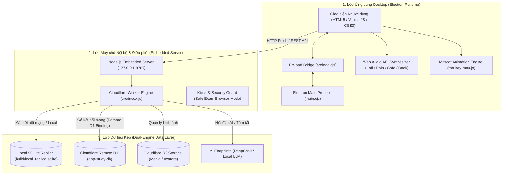

# 🌸 3TG — Học Vui Mỗi Ngày (Study With Me & Smart AI)

[](https://github.com/Anniehatani/appstudyAI)
[](https://github.com/Anniehatani/appstudyAI)
[](https://github.com/Anniehatani/appstudyAI)
[](https://github.com/Anniehatani/appstudyAI)
[](https://github.com/Anniehatani/appstudyAI)

> **3TG — Học Vui Mỗi Ngày** là nền tảng học tập thông minh toàn diện được thiết kế theo phong cách gamification sinh động của Duolingo kết hợp với Mascot độc quyền **Thỏ Bảy Màu**. Ứng dụng tích hợp phòng học ảo **Pomodoro & Lofi Room** chuẩn Kiosk/Safe Exam, trợ lý ảo **Bot 3TG AI** thông minh giải toán từng bước bằng LaTeX, mạng xã hội sinh viên **3TG Messenger**, Sổ tay ghi chú đa năng và hệ thống theo dõi học vụ/tính điểm GPA.

---

## 📑 MỤC LỤC
1. [Tổng quan dự án](#-t%E1%BB%95ng-quan-d%E1%BB%B1-%C3%A1n)
2. [Tính năng nổi bật](#-t%C3%ADnh-n%C4%83ng-n%E1%BB%95i-b%E1%BA%ADt)
   - [1. Phòng học ảo Pomodoro & Lofi Room (Study With Me)](#1-ph%C3%B2ng-h%E1%BB%8Dc-%E1%BA%A3o-pomodoro--lofi-room-study-with-me)
   - [2. Cố vấn Học vụ Bot 3TG AI (Đọc ngữ cảnh & Giải toán LaTeX)](#2-c%E1%BB%91-v%E1%BA%A5n-h%E1%BB%8Dc-v%E1%BB%A5-bot-3tg-ai-%C4%91%E1%BB%8Dc-ng%E1%BB%AF-c%E1%BA%A3nh--gi%E1%BA%A3i-to%C3%A1n-latex)
   - [3. Lộ trình học Gamification chuẩn Duolingo](#3-l%E1%BB%99-tr%C3%ACnh-h%E1%BB%8Dc-gamification-chu%E1%BA%A9n-duolingo)
   - [4. Cửa hàng & Hệ thống 8 Bộ Theme đa sắc](#4-c%E1%BB%ADa-h%C3%A0ng--h%E1%BB%87-th%E1%BB%91ng-8-b%E1%BB%99-theme-%C4%91a-s%E1%BA%AFc)
   - [5. Mạng xã hội sinh viên & 3TG Messenger](#5-m%E1%BA%A1ng-x%C3%A3-h%E1%BB%99i-sinh-vi%C3%AAn--3tg-messenger)
   - [6. Sổ tay ghi chú đa năng (Smart Notebook)](#6-s%E1%BB%95-tay-ghi-ch%C3%BA-%C4%91a-n%C4%83ng-smart-notebook)
   - [7. Cải thiện điểm & Tích hợp Cổng đào tạo IU](#7-c%E1%BA%A3i-thi%E1%BB%87n-%C4%91i%E1%BB%83m--t%C3%ADch-h%E1%BB%A3p-c%E1%BB%95ng-%C4%91%C3%A0o-t%E1%BA%A1o-iu)
3. [Kiến trúc kỹ thuật (Architecture)](#-ki%E1%BA%BFn-tr%C3%BAc-k%E1%BB%B9-thu%E1%BA%ADt-architecture)
4. [Cấu trúc thư mục dự án](#-c%E1%BA%A5u-tr%C3%BAc-th%C6%B0-m%E1%BB%A5c-d%E1%BB%B1-%C3%A1n)
5. [Cơ sở dữ liệu & Mô hình đồng bộ kép](#-c%C6%A1-s%E1%BB%9F-d%E1%BB%AF-li%E1%BB%87u--m%C3%B4-h%C3%ACnh-%C4%91%E1%BB%93ng-b%E1%BB%99-k%C3%A9p)
6. [Hướng dẫn cài đặt & Khởi chạy](#-h%C6%B0%E1%BB%9Bng-d%E1%BB%8Fn-c%C3%A0i-%C4%91%E1%BA%B7t--kh%E1%BB%9Fi-ch%E1%BA%A1y)
7. [Hướng dẫn đóng gói Desktop (Installer & Portable)](#-h%C6%B0%E1%BB%9Bng-d%E1%BB%8Fn-%C4%91%C3%B3ng-g%C3%B3i-desktop-installer--portable)
8. [Triển khai Cloudflare Workers (Production)](#-tri%E1%BB%83n-khai-cloudflare-workers-production)
9. [Nhật ký phiên bản & Lịch sử cập nhật (Changelog)](#-nh%E1%BA%ADt-k%C3%BD-phi%C3%AAn-b%E1%BA%A3n--l%E1%BB%8Bch-s%E1%BB%AD-c%E1%BA%ADp-nh%E1%BA%ADt-changelog)
10. [Bản quyền & Liên hệ](#-b%E1%BA%A3n-quy%E1%BB%81n--li%C3%AAn-h%E1%BB%87)

---

## 🌟 TỔNG QUAN DỰ ÁN

**3TG** được xây dựng nhằm giải quyết bài toán cốt lõi của học sinh, sinh viên trong thời đại kỹ thuật số: **Sự mất tập trung, nhàm chán khi tự học và áp lực ôn thi**.

Bằng việc kết hợp tinh tế giữa:
- **Gamification:** Biến việc học lý thuyết khô khan thành hành trình chinh phục cấp độ, mở khóa huy hiệu, duy trì ngọn lửa Streak và cạnh tranh lành mạnh trên bảng xếp hạng.
- **Mascot Thỏ Bảy Màu:** Nhân vật hoạt hình hài hước, phản ứng chân thực theo trạng thái học tập (làm đúng thì ăn mừng, làm sai thì ngơ ngác, afk thì ngủ gật, vào pomodoro thì cắm cúi viết bài).
- **Không gian Zen & Kiosk Mode:** Loại bỏ hoàn toàn sự xao nhãng của mạng xã hội trên máy tính, đưa sinh viên vào trạng thái "Dòng chảy" (Flow State).
- **Trí tuệ nhân tạo (AI):** Cố vấn học tập 24/7 đồng hành ngay trên màn hình, hỗ trợ đọc file bài giảng, giải thích công thức toán học từng bước rõ ràng.

---

## 🚀 TÍNH NĂNG NỔI BẬT

### 1. Phòng học ảo Pomodoro & Lofi Room (Study With Me)
Không gian tự học tập trung cao độ mô phỏng phòng thi an toàn (Safe Exam Browser / Kiosk Mode):
- **Chu kỳ chuẩn khoa học:** 25 phút Siêu Tập Trung (Focus Phase) luân phiên với 5 phút Giải Lao (Break Phase).
- **Cơ chế thưởng theo ca:** Mỗi ca 25 phút hoàn thành xuất sắc cộng ngay **+50 XP** và **+30 💎 Đá quý**. Tích lũy tuyến tính theo số ca học (1 ca = 1x, 2 ca = 2x, v.v.).
- **Chế độ Kiosk chống trốn học:** Tự động mở toàn màn hình, ẩn thanh tác vụ, chặn các phím tắt hệ thống nguy hiểm (`Alt + Tab`, `Win Key`, `F11`). Thoát khẩn cấp có xác nhận bằng `Ctrl + Q`.
- **Khóa thêm tệp khi đang học:** Tuyệt đối không cho phép mở cửa sổ File Explorer của hệ điều hành trong khi đang trong ca 25 phút để triệt tiêu mọi cám dỗ trốn học. Mọi tài liệu được nạp sẵn tại Sảnh chờ trước khi bắt đầu.
- **Mascot Thỏ Bảy Màu Chế độ Zen:** Khi không mở tài liệu, màn hình trung tâm hiển thị Mascot Thỏ Bảy Màu phóng to cực đại (size 340) ngồi cắm cúi viết bài với bong bóng thoại meme hài hước cùng vòng tròn tiến độ Pomodoro SVG sinh động.
- **Hệ thống 4 kênh âm thanh Chill 100% Offline (Web Audio API Synthesizer):**
  - 🎵 **Lofi Beats:** Tiến trình hòa thanh 16 hợp âm Jazz ấm áp kết hợp nhịp trống Boom-Bap đầy đặn (kick click transient 160Hz $\to$ 48Hz, rimshot/snare đanh gọn, swung hi-hats và tiếng nổ lách tách của đĩa than Vinyl).
  - 🌧️ **Tiếng Mưa (Rain Ambiance):** Bộ lọc Pink & Brown noise đa tầng với chu kỳ lượn sóng tự nhiên, kết hợp giọt nước tí tách ngẫu nhiên và tiếng sấm rền xa xa êm dịu.
  - ☕ **Quán Cafe (Terrace Cafe):** Tiếng ồn trắng nhẹ nhàng của gió trời ngoài ban công kết hợp tiếng thìa khuấy cốc sứ, tiếng lách cách đá viên chu kỳ 4–8s.
  - 📖 **Tiếng Lật Sách (Library Study):** Kích hoạt ngay âm thanh lật trang giấy giòn tan khi vừa chọn kênh, xen kẽ tiếng sột soạt bút chì ghi chú trên giấy tập sau mỗi 6–10s.
  - **Smooth Fade-In Ramp:** Âm thanh khởi động êm ái tăng dần đều trong 0.8s ở mức âm lượng an toàn (0.42), hoàn toàn không gây nổ loa hay giật mình.
- **Hỗ trợ đa định dạng tài liệu học tập không giới hạn:**
  - 📊 **PowerPoint (`.pptx`, `.ppt`):** Tự động giải nén XML nội bộ bằng JavaScript thuần trong Chromium, bóc tách toàn bộ slide bài giảng hiển thị dạng thẻ trực quan.
  - 📄 **Word (`.docx`, `.doc`):** Trích xuất văn bản tài liệu soạn thảo chuẩn chỉnh.
  - 💻 **Source Code (`.js`, `.py`, `.java`, `.cpp`, `.cs`, `.html`, `.css`, v.v.):** Trình đọc code nền tối chuyên nghiệp với thanh công cụ sao chép mã nguồn 1-click.
  - 🎬 **Video (`.mp4`, `.webm`):** Trình phát video bài giảng tích hợp đầy đủ nút điều khiển tốc độ và tua nhanh.
  - 🎧 **Audio (`.mp3`, `.wav`):** Trình phát bài giảng âm thanh với visualizer sóng nhạc.
  - 📑 **PDF & 🖼️ Hình ảnh:** Trình nhúng PDF toàn màn hình và hình ảnh sơ đồ sắc nét.
  - 🔒 **Bộ lọc an ninh:** Tự động phát hiện và ngăn chặn các tệp thực thi độc hại (`.exe`, `.dll`, `.bin`, `.iso`, `.msi`, `.bat`).

---

### 2. Cố vấn Học vụ Bot 3TG AI (Đọc ngữ cảnh & Giải toán LaTeX)
Trợ lý AI chuyên biệt được tích hợp trực tiếp vào thanh bên phải của phòng Pomodoro:
- **Đọc ngữ cảnh tài liệu trên màn hình (On-Screen Reading):** Có công tắc bật/tắt quyền riêng tư. Khi bật, Bot 3TG tự động nắm bắt tài liệu đang mở ở màn giữa (nội dung slide PowerPoint, đoạn văn bản Word, mã nguồn code hoặc giáo trình PDF) để giải đáp chính xác mà người dùng không cần sao chép dán lại.
- **Trình bày công thức Toán học chuẩn LaTeX:**
  - Hiển thị phân số trực quan $\frac{A}{B}$ với tử số trên mẫu số dưới và vạch phân số rõ nét.
  - Hỗ trợ đầy đủ đạo hàm riêng $\frac{\partial f}{\partial x}$, giới hạn $\lim_{(x,y) \to (0,0)}$, tích phân $\int$, tổng $\sum$, căn bậc hai $\sqrt{x}$, số mũ $x^2$, chỉ số dưới $r_x$.
  - Ký hiệu toán học và chữ cái Hy Lạp: $\to, \infty, \pm, \neq, \le, \ge, \approx, \alpha, \beta, \gamma, \Delta, \dots$
- **Phân luồng câu trả lời thông minh:**
  - Tuyệt đối không dính thành 1 khối văn bản khó nhìn.
  - Tự động tách biệt các bước giải bằng thẻ bước nổi bật (`>> **Bước 1**:`, `>> **Bước 2**:`) có viền hồng pastel đặc trưng.
  - Hộp mẹo nhớ (`>> **Mẹo nhớ**:`) và trích dẫn công thức (`>`) được đóng khung cách điệu.
- **Lưu vào Sổ tay 1-Click:** Nút "💾 Lưu vào Sổ tay" dưới mỗi câu trả lời của AI cho phép lưu ngay vào sổ tay học tập để ôn tập lâu dài.
- **Thanh mở lại Dock AI thông minh:** Khi thu gọn dock AI, thanh chuyển thành dải dọc 44px tinh tế với chữ `✨ CỐ VẤN BOT 3TG AI ◀`. Người dùng chỉ cần nhấp vào bất kỳ đâu trên thanh để mở rộng trở lại.

---

### 3. Lộ trình học Gamification chuẩn Duolingo
- **Kho học liệu khổng lồ:** Kết nối cơ sở dữ liệu với **10 môn học đại học**, **106 chương**, **4.094 bài học**, và **29.460 câu hỏi trắc nghiệm**.
- **Cơ chế tiến độ tương tác:** Bản đồ lộ trình bài học theo các đảo kiến thức, chia thành các bài học nhỏ (bitesize) từ dễ đến nâng cao.
- **Hệ thống Trái tim (Lives):** Người học có 5 trái tim; mỗi lần trả lời sai bị trừ 1 tim. Hết tim có thể dùng đá quý nạp lại hoặc luyện tập để hồi tim.
- **Ngọn lửa Streak:** Đếm chuỗi ngày học liên tục, kích hoạt hiệu ứng ngọn lửa bùng cháy và phần thưởng điểm danh hàng ngày.
- **Bảng xếp hạng (Leaderboard):** Xếp hạng thi đua theo tuần và tháng giữa các học viên, thúc đẩy tinh thần học tập nhóm.
- **Góc ôn câu sai (Mistake Review):** Tự động thu thập các câu hỏi làm sai vào một danh sách riêng để luyện tập lại cho đến khi thành thạo.

---

### 4. Cửa hàng & Hệ thống 8 Bộ Theme đa sắc
Shop vật phẩm phong phú với giá chỉ **50 💎 Đá quý** cho mỗi bộ giao diện:
- **8 Bộ Theme màu sắc thiết kế tỉ mỉ:**
  1. 🌸 **Tone Pink (Hồng Mộng Mơ):** Giao diện hồng phấn chủ đạo nguyên bản của 3TG.
  2. 🌊 **Ocean Blue (Đại Dương Xanh):** Xanh dương tươi mát, dịu mắt giúp giảm căng thẳng khi học lâu.
  3. 🌿 **Forest Green (Rừng Xanh Nhiệt Đới):** Xanh lá thiên nhiên, mang lại năng lượng tích cực và tập trung.
  4. ⚡ **Cyberpunk Neon (Neon Công Nghệ):** Tím than và hồng neon phá cách, kích thích sự sáng tạo.
  5. 🌇 **Sunset Orange (Hoàng Hôn Cam):** Sắc cam ấm áp, tràn đầy nhiệt huyết học tập.
  6. 🔮 **Lavender Dream (Tím Oải Hương):** Tím pastel thanh lịch, thư thái cho những đêm ôn thi.
  7. 🌌 **Midnight Velvet (Đêm Tối Tĩnh Lặng):** Dark mode tối ưu hóa cho màn hình OLED, bảo vệ mắt ban đêm.
  8. 👑 **Royal Gold (Hoàng Gia Sang Trọng):** Vàng kim quyền lực dành cho những học bá dẫn đầu bảng xếp hạng.
- **Tính năng Live Preview:** Cho phép xem trước hiệu ứng màu sắc trực tiếp trên giao diện Shop trước khi quyết định mua.
- **Áp dụng toàn diện 100%:** Màu sắc chủ đề được đồng bộ toàn diện trên toàn bộ ứng dụng: Background nền, Thanh bên (Sidebar), Thanh điều hướng (Topbar), Danh sách Tab, Bong bóng chat, Hộp thoại xác nhận, Thanh tiến độ, Các nút bấm chính.
- **Vật phẩm bổ trợ:** Mua thêm Tim hồi phục, Bùa đóng băng Streak (Streak Freeze), Bùa nhân đôi kinh nghiệm (Double XP).

---

### 5. Mạng xã hội sinh viên & 3TG Messenger
Không gian kết nối học tập giữa các sinh viên:
- **3TG Messenger:** Trò chuyện thời gian thực theo nhóm học tập và tin nhắn cá nhân riêng tư.
- **Trợ lý Bot 3TG trong khung chat:** Hỗ trợ điều khiển bằng lệnh chuyên dụng:
  - `!help` / `!menu`: Xem bảng hướng dẫn lệnh.
  - `!ai [câu hỏi]`: Đặt câu hỏi nhanh cho AI ngay trong cuộc trò chuyện nhóm.
  - `!sing [tên bài]`: Tìm kiếm giai điệu bài hát yêu thích.
  - `!troll`: Gửi meme hài hước giải tỏa căng thẳng.
  - `!info`: Xem chi tiết nhóm học, danh sách Trưởng & Phó nhóm.
  - `!clean`: Dọn dẹp tin nhắn tạm trong nhóm.
  - `!ping` / `!uptime`: Kiểm tra độ trễ và thời gian hoạt động của máy chủ.
  - `!chao`: Lời chào và mẹo học tập theo từng khung giờ trong ngày.
- **Hồ sơ cá nhân phong phú:**
  - Khung Avatar trang trí, ảnh bìa, danh hiệu cá nhân, hiển thị biểu tượng trạng thái học tập (Đang học bài 🎧, Đang ôn thi 📚, Đang chill ☕, v.v.).
  - **Liên kết Mạng xã hội đa nền tảng:** Kết nối trang cá nhân Facebook, Instagram, TikTok, Threads, GitHub, Locket để kết nối bạn bè sâu sắc hơn.
  - Lưu trữ và đồng bộ hóa an toàn lên Cloudflare D1 theo tài khoản người dùng.

---

### 6. Sổ tay ghi chú đa năng (Smart Notebook)
- **Công cụ soạn thảo phong phú:** Lựa chọn kiểu giấy (kẻ ngang, ô li toán học, chấm dot, giấy trắng trơn).
- **Vẽ tay tự do (Canvas Drawing):** Hỗ trợ viết vẽ bằng chuột hoặc bút cảm ứng, vẽ sơ đồ tư duy, chèn hình học cơ bản.
- **Chèn công thức & Máy tính khoa học:** Bộ gõ công thức toán học và bảng tính khoa học tích hợp ngay cạnh trang viết.
- **Tự động lưu (Auto-save):** Tự động lưu trữ nội dung nháp sau 500ms thao tác, không lo mất mát dữ liệu.
- **Liên kết bài học:** Gắn nhãn ghi chú theo môn học và chương bài cụ thể.

---

### 7. Cải thiện điểm & Tích hợp Cổng đào tạo IU
- **Tính toán GPA & Tích lũy:** Bảng tổng kết kết quả học tập, tự động tính điểm trung bình tích lũy theo thang điểm 4 và thang điểm 10.
- **Dự báo cải thiện điểm:** Thuật toán tính toán số tín chỉ và điểm số cần đạt ở các kỳ tới để đạt danh hiệu Khá, Giỏi, Xuất sắc.
- **Tích hợp cổng đào tạo IU (International University / Đại học Quốc tế):**
  - Mở cửa sổ đăng nhập an toàn vào cổng sinh viên IU thông qua Electron Webview/BrowserWindow.
  - Tự động nạp bảng điểm, lịch thi, danh sách môn học đã đăng ký trực tiếp vào hồ sơ 3TG.

---

## 🏗️ KIẾN TRÚC KỸ THUẬT (ARCHITECTURE)

Hệ thống được xây dựng theo mô hình **Hybrid Desktop & Serverless Web**, cho phép vừa hoạt động như một ứng dụng desktop offline độc lập, vừa kết nối liền mạch với nền tảng điện toán đám mây Cloudflare:



### Các công nghệ nền tảng sử dụng:
| Phân hệ | Công nghệ sử dụng | Mục đích & Ưu điểm |
| :--- | :--- | :--- |
| **Desktop Shell** | Electron 45, Node.js v20+ | Đóng gói ứng dụng desktop native, quản lý cửa sổ Kiosk, gọi IPC bảo mật |
| **Frontend UI** | ES Modules, Vanilla JavaScript, CSS3 Variables | Tốc độ tải trang 0ms, không phụ thuộc framework cồng kềnh, mượt mà |
| **Synthesizer** | Web Audio API (Oscillators, BiquadFilters, LFO, Noise Buffers) | Tạo âm thanh phòng học 100% bằng code toán học, dung lượng 0KB, không cần file MP3 |
| **Backend Runtime** | Cloudflare Workers & Node.js Embedded Server | Chạy cùng 1 mã nguồn backend cả trên máy cục bộ lẫn trên Cloudflare edge |
| **Cơ sở dữ liệu** | Cloudflare D1 (Serverless SQLite) & `better-sqlite3` | Lưu trữ dữ liệu đám mây phân tán toàn cầu kết hợp bản sao lưu offline tại chỗ |
| **Đóng gói** | Electron Builder, NSIS Target, Portable Target | Xuất file Setup cài đặt tự động và file Portable chạy ngay không cần cài |

---

## 📂 CẤU TRÚC THƯ MỤC DỰ ÁN

```text
app study 2/
├── .dev.vars                      # Biến môi trường local (Cloudflare secrets)
├── .gitignore                     # Cấu hình bỏ qua git (dist, cache, node_modules)
├── package.json                   # Cấu hình dependencies, build scripts & metadata
├── wrangler.jsonc                 # Cấu hình Cloudflare Worker, D1 database & R2 bucket bindings
├── README.md                      # Tài liệu tổng quan dự án (File này)
│
├── build/                         # Tài nguyên phục vụ đóng gói ứng dụng
│   ├── icon.ico                   # Biểu tượng ứng dụng Desktop
│   └── local_replica.sqlite       # Bản sao lưu SQLite dự phòng offline
│
├── dist-electron/                 # Thư mục xuất bản ứng dụng Desktop
│   ├── 3TG Học Vui Mỗi Ngày Setup 9.9.9.exe  # Bản cài đặt NSIS tự động
│   └── 3TG Học Vui Mỗi Ngày 9.9.9.exe        # Bản Portable x64 chạy ngay
│
├── electron/                      # Mã nguồn tầng Electron Desktop
│   ├── main.cjs                   # Quản lý vòng đời ứng dụng, Kiosk mode, phím tắt Ctrl+Q
│   ├── preload.cjs                # Context bridge cầu nối giao tiếp an toàn IPC
│   ├── embedded-server.cjs        # Máy chủ HTTP nhúng cục bộ (127.0.0.1:8787)
│   └── iu/                        # Tích hợp cổng đăng nhập và nạp điểm IU
│
├── public/                        # Giao diện người dùng (Frontend Web / Client)
│   ├── index.html                 # Trang HTML chính của ứng dụng
│   ├── app.js                     # Điều phối luồng ứng dụng chính, định tuyến trang, state
│   ├── pomodoro.js                # Trình điều khiển Phòng Pomodoro, Lofi Synth, Trình đọc file & Bot AI
│   ├── tho-bay-mau.js             # Động cơ diễn hoạt Mascot Thỏ Bảy Màu (SVG Animation)
│   ├── store.js                   # Cửa hàng vật phẩm, 8 bộ Theme đa sắc & Live Preview
│   ├── social.js                  # Mạng xã hội, danh sách bạn bè, 3TG Messenger, bot lệnh
│   ├── notes.js                   # Sổ tay ghi chú thông minh, canvas vẽ tay, máy tính
│   ├── academic.js                # Quản lý học tập, tính điểm GPA, cải thiện điểm
│   └── styles.css                 # Toàn bộ mã kiểu dáng CSS3, Dark Mode, Themes, Math & Layout
│
├── src/                           # Mã nguồn backend (Cloudflare Worker Engine)
│   └── index.js                   # Xử lý toàn bộ các API endpoint (/api/...) và tương tác database
│
└── scripts/                       # Các kịch bản tiện ích và kiểm thử tự động
    ├── migrate_remote_d1.cjs      # Đồng bộ schema lên cơ sở dữ liệu Cloudflare D1 Remote
    ├── convert_icon.py            # Chuyển đổi icon chuẩn Windows
    ├── verify_e2e.cjs             # Kiểm thử tự động luồng hệ thống E2E
    └── check_collabs.cjs          # Kiểm tra tính toàn vẹn cơ sở dữ liệu
```

---

## 💾 CƠ SỞ DỮ LIỆU & MÔ HÌNH ĐỒNG BỘ KÉP

Hệ thống sử dụng cơ sở dữ liệu quan hệ **Cloudflare D1** làm nguồn chân lý (Source of Truth), song hành cùng **SQLite Local Replica** nằm ngay trong thư mục ứng dụng để đảm bảo tốc độ phản hồi tức thì và khả năng chạy offline.

### Các bảng dữ liệu chính:
| Tên bảng | Chức năng chính |
| :--- | :--- |
| `subjects` | Danh mục 10 môn học chính khóa đại học |
| `chapters` | 106 chương học phân cấp theo từng môn |
| `lessons` | 4.094 bài giảng lý thuyết kèm video và tài liệu |
| `questions` | 29.460 câu hỏi trắc nghiệm kiểm tra kiến thức kèm lời giải |
| `profiles` | Hồ sơ người dùng: tên, avatar R2, khung viền, danh hiệu, **social_links**, **status_icon** |
| `user_stats` | Chỉ số người học: Level, XP, số lượng Đá quý, số Tim, chuỗi ngày Streak |
| `user_progress`| Tiến độ hoàn thành từng bài học, điểm số đạt được, số sao |
| `user_notes` | Các trang Sổ tay ghi chú cá nhân, nội dung canvas nét vẽ |
| `user_pomodoro_sessions` | Lịch sử các ca học Pomodoro: số phút, số ca hoàn thành, phần thưởng nhận được |
| `user_purchases` | Danh sách các bộ theme và vật phẩm đã mở khóa trong Shop |
| `messenger_conversations` | Danh sách các phòng chat nhóm và hội thoại cá nhân |
| `messenger_messages` | Toàn bộ tin nhắn trao đổi, biểu cảm cảm xúc và lệnh của Bot |

### Cơ chế tự phục hồi lỗi & Đồng bộ:
- Khi có mạng Internet: Mọi thao tác ghi (hoàn thành ca học, mua theme, đổi mạng xã hội) được đồng bộ tức thì lên Cloudflare D1 qua REST API.
- Khi mất mạng hoặc xảy ra lỗi kết nối: Hệ thống tự động kích hoạt **Local Fallback Engine**, lưu tạm vào bản sao lưu `build/local_replica.sqlite` và tự động đồng bộ bù ngay khi có kết nối trở lại.

---

## 💻 HƯỚNG DẪN CÀI ĐẶT & KHỞI CHẠY

### 1. Yêu cầu môi trường
- **Node.js:** Phiên bản `>= 20.x`
- **npm:** Phiên bản `>= 10.x`
- **Git:** Đã cài đặt trên máy
- *(Tùy chọn)* Python 3.x nếu muốn build lại icon `.ico`

### 2. Cài đặt các gói phụ thuộc
```bash
# Clone dự án từ GitHub
git clone https://github.com/Anniehatani/appstudyAI.git
cd appstudyAI

# Cài đặt thư viện dependencies
npm install
```

### 3. Cấu hình biến môi trường
Tạo file `.dev.vars` tại thư mục gốc với các cấu hình tương ứng:
```ini
CLOUDFLARE_API_TOKEN="your-cloudflare-api-token"
CLOUDFLARE_ACCOUNT_ID="your-account-id"
CLOUDFLARE_D1_DATABASE_ID="your-d1-database-id"
DEEPSEEK_API_KEY="your-deepseek-or-openai-api-key"
LOCAL_AI_ENDPOINT="https://api.deepseek.com/chat/completions"
```

### 4. Khởi chạy ứng dụng

#### Chế độ Desktop App (Electron) cho nhà phát triển:
```bash
npm run electron
# hoặc
npm start
```
Ứng dụng sẽ tự động kích hoạt máy chủ nhúng tại `http://127.0.0.1:8787` và mở cửa sổ Desktop.

#### Chế độ Web App (Cloudflare Wrangler):
```bash
npm run web
```
Mở trình duyệt tại địa chỉ hiển thị bởi Wrangler (thường là `http://localhost:8787`).

---

## 📦 HƯỚNG DẪN ĐÓNG GÓI DESKTOP (INSTALLER & PORTABLE)

Dự án đã cấu hình sẵn kịch bản đóng gói tự động qua `electron-builder` dành cho hệ điều hành Windows (x64):

```bash
# Đóng gói cả bộ cài Setup (NSIS) và bản chạy ngay (Portable):
npm run electron:dist
```

Sau khi quá trình hoàn tất, các tệp thực thi sẽ xuất hiện tại thư mục `dist-electron/`:
- `3TG Học Vui Mỗi Ngày Setup 9.9.9.exe`: Bộ cài đặt chính thức, tự tạo shortcut Desktop và Start Menu.
- `3TG Học Vui Mỗi Ngày 9.9.9.exe`: Bản Portable di động, copy vào USB chạy ngay không cần cài đặt.

---

## ☁️ TRIỂN KHAI CLOUDFLARE WORKERS (PRODUCTION)

Để xuất bản ứng dụng lên mạng đám mây toàn cầu của Cloudflare:

1. Đăng nhập Wrangler:
   ```bash
   npx wrangler login
   ```
2. Thiết lập các Secret khóa API bảo mật:
   ```bash
   npx wrangler secret put DEEPSEEK_API_KEY
   ```
3. Triển khai (Deploy):
   ```bash
   npm run deploy
   ```

Toàn bộ tài nguyên tĩnh trong thư mục `public/` cùng API backend `src/index.js` sẽ được tải lên Cloudflare Workers và phân phối qua mạng lưới Edge trên 300+ thành phố trên toàn thế giới.

---

## 📜 NHẬT KÝ PHIÊN BẢN & LỊCH SỬ CẬP NHẬT (CHANGELOG)

### 🚀 Phiên bản 9.9.9 (Bản cập nhật Siêu cấp - Hiện tại)
- **Phòng học Pomodoro & Lofi Room:**
  - Tăng kích thước Mascot Thỏ Bảy Màu lên **size 340** cực lớn và sắc nét ở chế độ Zen.
  - Thiết kế lại âm thanh: bổ sung nhịp trống Boom-Bap sống động cho Lofi, tiếng ồn trắng terrace ngoài trời kèm tiếng đá và cốc va chạm cho Cafe, tiếng lật sách tức thì cho Library.
  - Khắc phục triệt để hiện tượng nổ âm lượng khi mới mở bằng thuật toán **Smooth Fade-In 0.8s**.
  - Bổ sung thanh mở lại dock AI 44px khi thu gọn `✨ CỐ VẤN BOT 3TG AI ◀`.
  - Khóa hoàn toàn chức năng mở file khi đang học để duy trì kỷ luật (Safe Exam Mode).
  - Mở rộng hỗ trợ định dạng: PowerPoint (`.pptx`), Word (`.docx`), Mã nguồn Code, Video (`.mp4`), Audio (`.mp3`).
- **Nâng cấp Cố vấn Bot 3TG AI:**
  - Tích hợp bộ giải mã công thức Toán học chuẩn LaTeX: phân số hai tầng, đạo hàm riêng, giới hạn, số mũ, chỉ số dưới.
  - Phân luồng câu trả lời thông minh thành các bước (Bước 1, Bước 2, Mẹo nhớ) có viền màu đẹp mắt.
  - Đọc ngữ cảnh trực tiếp từ các file PowerPoint, Word, Code đang mở trên màn hình.
- **Hệ thống Theme Đa sắc & Shop:**
  - Ra mắt 8 bộ Theme màu sắc mới với giá 50 Đá quý.
  - Hỗ trợ Live Preview trực tiếp trong Shop trước khi mua.
  - Áp dụng màu chủ đề 100% không sót bất kỳ thành phần nào trên ứng dụng.
- **Mạng xã hội & Hồ sơ:**
  - Bổ sung liên kết mạng xã hội (Facebook, Instagram, TikTok, Threads, GitHub, Locket) vào trang cá nhân.
  - Đồng bộ hóa toàn diện dữ liệu `social_links`, `status_icon`, `user_pomodoro_sessions` lên Cloudflare D1 Remote và SQLite Replica.

### 🌟 Sprint 3 — Hoàn thiện đóng gói & Hệ sinh thái
- Hoàn thiện bộ cài đặt Setup và Portable v9.9.9.
- Khung avatar, hình nền mặc định và phân quyền API bảo mật chống vượt quyền.
- Tối ưu giao diện Cố vấn AI, hiệu ứng gõ chữ và Dark Mode Velvet.
- Kiểm thử toàn diện E2E và tối ưu mở nhanh 1-2 giây trên máy tính cấu hình yếu.

### 🌟 Sprint 2 — Gamification & Học vụ chuyên sâu
- Xây dựng bản đồ học tập Duolingo, tính năng Streak ngọn lửa, bảo vệ Tim.
- Tích hợp cổng sinh viên Đại học IU (International University), nạp bảng điểm tự động.
- Phát triển Sổ tay ghi chú đa năng kèm Canvas vẽ tay và máy tính khoa học.

### 🌟 Sprint 1 — Nền tảng cốt lõi
- Xây dựng cơ sở dữ liệu 10 môn học, 106 chương, 4.094 bài học, 29.460 câu hỏi trên Cloudflare D1.
- Thiết kế hệ thống diễn hoạt Mascot Thỏ Bảy Màu bằng SVG động.
- Xây dựng 3TG Messenger và hệ thống bot tiện ích tương tác nhóm.

---

## 📄 BẢN QUYỀN & LIÊN HỆ

- **Đơn vị phát triển:** Tone Pink Group — Dự án 3TG Study
- **Mascot Design:** Đồng hành cùng tinh thần hài hước của Mascot Thỏ Bảy Màu
- **Kho lưu trữ GitHub:** [https://github.com/Anniehatani/appstudyAI](https://github.com/Anniehatani/appstudyAI)
- **Bản quyền:** Copyright © 2026 3TG Study. Mọi quyền được bảo lưu.

---
*Chúc bạn có những giờ học tập thật say mê, bùng nổ năng lượng và đạt điểm A+ cùng 3TG & Thỏ Bảy Màu! 🌸✨*
