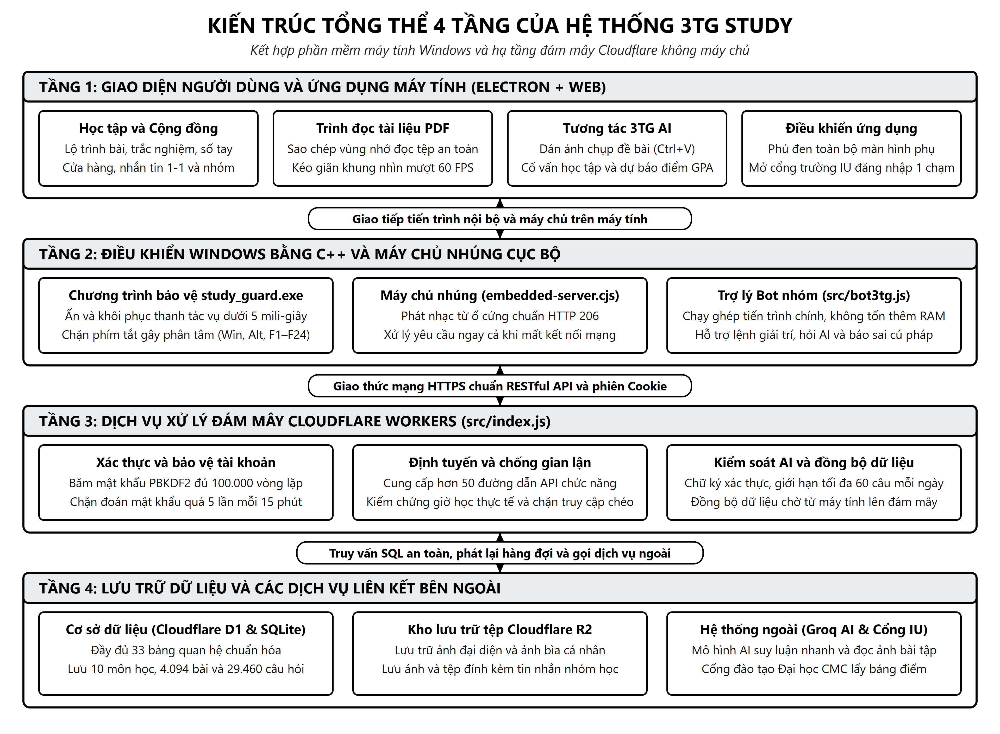

# 3TG Study — Ứng dụng hỗ trợ học tập thông minh (`V29.9.07`)

> **Đồ án môn Công nghệ phần mềm (`INFO2011`) — Lớp N08 — Trường Đại học CMC**  
> **Nhóm thực hiện (TONE PINK):** Lê Văn An (`BAI250001`, Nhóm trưởng), Nguyễn Như Quỳnh (`BCS252491`), Nguyễn Văn Tú (`BIT250364`)  
> **Giảng viên hướng dẫn:** ThS. Nguyễn Thị Vân Anh

**3TG Study** là hệ sinh thái hỗ trợ học tập thông minh trên máy tính Windows (Electron + C++ Win32) kết hợp điện toán đám mây (Cloudflare Workers, D1, R2), giúp sinh viên học tập trung không xao nhãng, ôn luyện theo lộ trình, theo dõi điểm rèn luyện GPA và hỏi đáp bài tập bằng trí tuệ nhân tạo.

---

## 1. Tính năng cốt lõi

- **Phòng học tập trung chống xao nhãng (`study_guard.exe`):** Ẩn thanh tác vụ Windows an toàn, chặn các phím chuyển cửa sổ, phủ đen toàn bộ màn hình phụ và tự động khôi phục nguyên vẹn trong dưới `5 ms` ngay cả khi thoát ứng dụng đột ngột; xác thực thời gian học thực tế trên máy chủ trước khi thưởng.
- **Lộ trình học tập & ôn luyện:** Tổ chức `10` môn học cơ sở ngành, `106` chương, `4.094` bài học và `29.460` câu hỏi trắc nghiệm; tự động gom câu làm sai để ôn lại và lưu ghi chú gắn trực tiếp theo từng bài học.
- **Đồng bộ Cổng đào tạo IU & dự báo GPA:** Đăng nhập một chạm lấy bảng điểm, tính GPA hệ 4 và hệ 10, mô phỏng nâng điểm từng môn theo trọng số tín chỉ và hỗ trợ nút ngắt kết nối xóa sạch bản ghi bảng điểm trong cơ sở dữ liệu.
- **Trợ lý `3TG AI` & đọc tài liệu tại chỗ:** Hỗ trợ dán ảnh đề bài trực tiếp bằng `Ctrl+V` để giải thích từng bước; trình đọc tài liệu PDF mượt mà (`slice(0)` chống trắng trang) và phát nhạc trực tiếp từ ổ cứng qua máy chủ nhúng chuẩn `HTTP 206` không tốn băng thông đám mây.
- **Hoạt động bền bỉ khi mất mạng:** Kết quả học tập được lưu tạm vào SQLite cục bộ và hàng đợi `sync_outbox`, tự động đồng bộ lại lên Cloudflare D1 ngay khi có Internet.
- **Bảo mật & Cộng đồng:** Mã hóa mật khẩu `PBKDF2-HMAC-SHA256` (`100.000` vòng lặp + muối `16 byte` ngẫu nhiên), giới hạn thử sai đăng nhập, cookie phiên `HttpOnly`, kết bạn 2 chiều, nhắn tin nhóm phân quyền tích hợp `Bot 3TG`, cửa hàng `38` vật phẩm, `5` nhiệm vụ mỗi ngày, `10` thành tích và bảng xếp hạng tuần.

---

## 2. Kiến trúc hệ thống & Cơ sở dữ liệu

Hệ thống áp dụng kiến trúc lai 4 tầng gồm tầng giao diện Desktop (Electron), tầng điều khiển hệ điều hành (`C++` `study_guard.exe`) + máy chủ nhúng cục bộ (`embedded-server.cjs`), tầng xử lý biên (`Cloudflare Workers`) và tầng lưu trữ (`Cloudflare D1` chuẩn `3NF` với `33` bảng nghiệp vụ + bản sao SQLite cục bộ `build/local_replica.sqlite` + `Cloudflare R2`).



---

## 3. Cài đặt, chạy cục bộ và kiểm thử

### Yêu cầu môi trường
- Node.js (`>= 18`), npm và tài khoản Cloudflare Wrangler (nếu chạy Worker kết nối D1/R2 từ xa).

### Chạy ứng dụng ở chế độ phát triển
```bash
npm install
npm run dev
```

### Chạy bộ kiểm thử tự động toàn hệ thống (`38` tiêu chí)
```bash
node scripts/test_sprint6_full_suite.cjs
```
Kết quả xác minh bản phát hành `V29.9.07`: **`38 PASS, 0 FAIL`** (kiểm tra CSDL `build/local_replica.sqlite`, logic xóa bảng điểm IU, phản hồi `3TG AI`, nhị phân `build/study_guard.exe`, khóa màn hình phụ, phát nhạc `HTTP 206`, đọc PDF và giữ phiên đăng nhập).

> Ghi chú bảo mật: Các tệp chứa khóa bí mật như `.env` và `.dev.vars` được loại khỏi Git và quá trình đóng gói bộ cài.

---

## 4. Tài liệu dự án & Báo cáo tổng kết

- **Báo cáo tổng kết đồ án:** [Bao_Cao_Tong_Ket_Do_An_3TG_Study_TONE_PINK.docx](tổng%20kết%20dự%20án/Bao_Cao_Tong_Ket_Do_An_3TG_Study_TONE_PINK.docx)
- **Sơ đồ thiết kế UML & quy trình:** Thư mục [`report_assets/`](report_assets/)
- **Nhật ký 6 giai đoạn phát triển (Sprints):**
  - [Sprint 1](tổng%20kết%20dự%20án/Sprint_1.md) · [Sprint 2](tổng%20kết%20dự%20án/Sprint_2.md) · [Sprint 3](tổng%20kết%20dự%20án/Sprint_3.md) · [Sprint 4](tổng%20kết%20dự%20án/Sprint_4.md) · [Sprint 5](tổng%20kết%20dự%20án/Sprint_5.md) · [Sprint 6](tổng%20kết%20dự%20án/Sprint_6.md)
