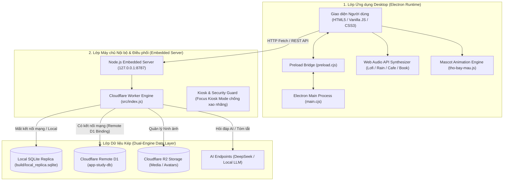

# 🌸 3TG — Học Vui Mỗi Ngày (Study With Me & Smart AI)

[](https://github.com/Anniehatani/appstudyAI)
[](https://github.com/Anniehatani/appstudyAI)
[](https://github.com/Anniehatani/appstudyAI)
[](https://github.com/Anniehatani/appstudyAI)
[](https://github.com/Anniehatani/appstudyAI)

> **3TG — Học Vui Mỗi Ngày** là nền tảng học tập thông minh toàn diện được thiết kế theo phong cách gamification sinh động của Duolingo kết hợp với Mascot độc quyền **Thỏ Bảy Màu**. Ứng dụng tích hợp phòng học ảo **Pomodoro & Lofi Room** chuẩn Kiosk/Safe Exam, trợ lý ảo **Bot 3TG AI** thông minh giải toán từng bước bằng LaTeX, mạng xã hội sinh viên **3TG Messenger**, Sổ tay ghi chú đa năng và hệ thống theo dõi học vụ/tính điểm GPA.

---

## 📑 MỤC LỤC
1. [Tổng quan dự án](#-t%E1%BB%95ng-quan-d%E1%BB%B1-%C3%A1n)
2. [Chi tiết tính năng chuyên sâu](#-chi-ti%E1%BA%BFt-t%C3%ADnh-n%C4%83ng-chuy%C3%AAn-s%C3%A2u)
   - [1. Cửa hàng (Shop) & Hệ thống 8 Bộ Theme Đa Sắc Toàn Diện](#1-c%E1%BB%ADa-h%C3%A0ng-shop--h%E1%BB%87-th%E1%BB%91ng-8-b%E1%BB%99-theme-%C4%91a-s%E1%BA%AFc-to%C3%A0n-di%E1%BB%87n)
   - [2. Trang cá nhân (Profile) & Mạng xã hội kết nối bạn bè](#2-trang-c%C3%A1-nh%C3%A2n-profile--m%E1%BA%A1ng-x%C3%A3-h%E1%BB%99i-k%E1%BA%BFt-n%E1%BB%91i-b%E1%BA%A1n-b%C3%A8)
   - [3. Hỏi AI vào Note (Hỏi 3TG AI & Sổ tay ghi chú thông minh)](#3-h%E1%BB%8Fi-ai-v%C3%A0o-note-h%E1%BB%8Fi-3tg-ai--s%E1%BB%95-tay-ghi-ch%C3%BA-th%C3%B4ng-minh)
   - [4. Phòng học ảo Pomodoro & Lofi Room (Study With Me)](#4-ph%C3%B2ng-h%E1%BB%8Dc-%E1%BA%A3o-pomodoro--lofi-room-study-with-me)
   - [5. Cố vấn Học vụ Bot 3TG AI trong phòng học](#5-c%E1%BB%91-v%E1%BA%A5n-h%E1%BB%8Dc-v%E1%BB%A5-bot-3tg-ai-trong-ph%C3%B2ng-h%E1%BB%8Dc)
   - [6. Lộ trình học Gamification chuẩn Duolingo](#6-l%E1%BB%99-tr%C3%ACnh-h%E1%BB%8Dc-gamification-chu%E1%BA%A9n-duolingo)
   - [7. Mạng xã hội sinh viên & 3TG Messenger](#7-m%E1%BA%A1ng-x%C3%A3-h%E1%BB%99i-sinh-vi%C3%AAn--3tg-messenger)
   - [8. Cải thiện điểm & Tích hợp Cổng đào tạo IU](#8-c%E1%BA%A3i-thi%E1%BB%87n-%C4%91i%E1%BB%83m--t%C3%ADch-h%E1%BB%A3p-c%E1%BB%95ng-%C4%91%C3%A0o-t%E1%BA%A1o-iu)
3. [Kiến trúc kỹ thuật (Architecture)](#-ki%E1%BA%BFn-tr%C3%BAc-k%E1%BB%B9-thu%E1%BA%ADt-architecture)
4. [Cấu trúc thư mục dự án](#-c%E1%BA%A5u-tr%C3%BAc-th%C6%B0-m%E1%BB%A5c-d%E1%BB%B1-%C3%A1n)
5. [Cơ sở dữ liệu & Mô hình đồng bộ kép](#-c%C6%A1-s%E1%BB%9F-d%E1%BB%AF-li%E1%BB%87u--m%C3%B4-h%C3%ACnh-%C4%91%E1%BB%93ng-b%E1%BB%99-k%C3%A9p)
6. [Hướng dẫn cài đặt & Khởi chạy](#-h%C6%B0%E1%BB%9Bng-d%E1%BB%8Fn-c%C3%A0i-%C4%91%E1%BA%B7t--kh%E1%BB%9Fi-ch%E1%BA%A1y)
7. [Hướng dẫn đóng gói Desktop (Installer & Portable)](#-h%C6%B0%E1%BB%9Bng-d%E1%BB%8Fn-%C4%91%C3%B3ng-g%C3%B3i-desktop-installer--portable)
8. [Triển khai Cloudflare Workers (Production)](#-tri%E1%BB%83n-khai-cloudflare-workers-production)
9. [Nhật ký phiên bản & Lịch sử cập nhật (Changelog)](#-nh%E1%BA%ADt-k%C3%BD-phi%C3%AAn-b%E1%BA%A3n--l%E1%BB%8Bch-s%E1%BB%AD-c%E1%BA%ADp-nh%E1%BA%ADt-changelog)
10. [Bản quyền & Liên hệ](#-b%E1%BA%A3n-quy%E1%BB%81n--li%C3%AAn-h%E1%BB%87)

---

## 🌟 TỔNG QUAN DỰ ÁN

**3TG** được xây dựng nhằm giải quyết bài toán cốt lõi của học sinh, sinh viên trong thời đại kỹ thuật số: **Sự mất tập trung, nhàm chán khi tự học và áp lực ôn thi**.

Bằng việc kết hợp tinh tế giữa:
- **Gamification:** Biến việc học lý thuyết khô khan thành hành trình chinh phục cấp độ, mở khóa huy hiệu, duy trì ngọn lửa Streak và cạnh tranh lành mạnh trên bảng xếp hạng.
- **Mascot Thỏ Bảy Màu:** Nhân vật hoạt hình hài hước, phản ứng chân thực theo trạng thái học tập (làm đúng thì ăn mừng, làm sai thì ngơ ngác, afk thì ngủ gật, vào pomodoro thì cắm cúi viết bài).
- **Không gian Zen & Kiosk Mode:** Loại bỏ hoàn toàn sự xao nhãng của mạng xã hội trên máy tính, đưa sinh viên vào trạng thái "Dòng chảy" (Flow State).
- **Trí tuệ nhân tạo (AI):** Cố vấn học tập 24/7 đồng hành ngay trên màn hình, hỗ trợ đọc file bài giảng, giải thích công thức toán học từng bước rõ ràng.

---

## 💎 CHI TIẾT TÍNH NĂNG CHUYÊN SÂU

### 1. Cửa hàng (Shop) & Hệ thống 8 Bộ Theme Đa Sắc Toàn Diện
Cửa hàng vật phẩm được xây dựng chuyên nghiệp, đáp ứng sở thích cá nhân hóa của từng học viên với giá cực kỳ hợp lý: chỉ **50 💎 Đá quý** cho mỗi bộ theme vĩnh viễn (kiếm được dễ dàng qua các ca học Pomodoro và hoàn thành bài học):

#### 🎨 Danh mục 8 Bộ Theme Màu Sắc Độc Quyền (`THEMES_REGISTRY`):
| STT | Mã Theme | Tên Bộ Theme | Màu chủ đạo / Accent | Gradient & Tone Dots | Giá bán | Ý nghĩa & Cảm hứng thiết kế |
| :---: | :--- | :--- | :---: | :---: | :---: | :--- |
| **1** | `theme_sakura_pink` | **Hoa Anh Đào (Tone Pink Sakura)** | `#ff4b82` | `linear-gradient(135deg, #ff4b82 0%, #ff758c 100%)` | **0 💎 (Mặc định)** | Sắc hồng hoa anh đào pastel ngọt ngào signature của 3TG, tươi trẻ, ấm áp và tràn đầy cảm hứng học tập. |
| **2** | `theme_ocean_blue` | **Xanh Đại Dương (Cyber Ocean)** | `#0284c7` | `linear-gradient(135deg, #0284c7 0%, #38bdf8 100%)` | **50 💎** | Tông xanh biển sâu và xanh cyan công nghệ cao mát mắt, gia tăng 200% khả năng tập trung khi làm bài. |
| **3** | `theme_emerald_forest`| **Rừng Ngọc Lục Bảo (Emerald Mint)** | `#059669` | `linear-gradient(135deg, #059669 0%, #34d399 100%)` | **50 💎** | Tông xanh ngọc lục bảo và bạc hà dịu nhẹ, xoa dịu mắt mỏi khi ôn thi thâu đêm. |
| **4** | `theme_sunset_amber` | **Hoàng Hôn Hổ Phách (Sunset Amber)** | `#ea580c` | `linear-gradient(135deg, #ea580c 0%, #f97316 100%)` | **50 💎** | Sự hòa quyện giữa sắc cam hoàng hôn và vàng hổ phách rực rỡ, truyền lửa nhiệt huyết và đam mê chinh phục. |
| **5** | `theme_royal_amethyst`| **Tím Thạch Anh (Royal Amethyst)** | `#9333ea` | `linear-gradient(135deg, #9333ea 0%, #c084fc 100%)` | **50 💎** | Tông tím hoàng gia quý phái, biểu tượng của trí tuệ đỉnh cao và phong cách học tập sang trọng. |
| **6** | `theme_crimson_ruby` | **Huyết Long Ruby (Crimson Blood)** | `#e11d48` | `linear-gradient(135deg, #e11d48 0%, #fb7185 100%)` | **50 💎** | Sắc đỏ ruby rực lửa của những chiến binh kiên cường, sẵn sàng bứt phá mọi bảng xếp hạng. |
| **7** | `theme_cyber_lime` | **Vàng Chanh Cyberpunk (Cyber Lime)** | `#65a30d` | `linear-gradient(135deg, #65a30d 0%, #a3e635 100%)` | **50 💎** | Sắc vàng chanh neon điện tử đậm chất công nghệ tương lai, phá cách và kích thích tư duy logic. |
| **8** | `theme_vintage_mocha` | **Trà Sữa Caramel (Vintage Mocha)** | `#b45309` | `linear-gradient(135deg, #b45309 0%, #fbbf24 100%)` | **50 💎** | Tông nâu caramel cà phê ấm cúng, thư thái như đang ngồi học tại một quán cafe vintage lofi. |

#### 👁️ Tính năng Live Preview (Xem trước trực tiếp thời gian thực):
- Khi duyệt trong Shop, người dùng có thể nhấp **"👁️ Xem trước"** ở bất kỳ bộ theme nào.
- Hệ thống áp dụng ngay thuộc tính `data-color-theme` lên thẻ `<html>` và cập nhật biến CSS thời gian thực **ngay lập tức mà không cần tải lại trang**, cho phép người dùng lướt thử ứng dụng xem màu sắc có hợp mắt không trước khi quyết định chi 50 Đá quý.
- Thanh công cụ phía dưới cho phép: **"✅ Áp dụng & Lưu"** hoặc **"✕ Hủy xem trước"** để quay về theme cũ an toàn.

#### 💯 Cam kết Phủ sóng Màu sắc Toàn diện 100% (Không sót vị trí nào):
Bộ theme được liên kết thông qua hệ thống biến CSS3 toàn cục (`--theme-accent`, `--theme-accent-hover`, `--theme-accent-soft`, `--theme-border`, `--theme-gradient`), tác động đồng bộ lên:
- **Nền toàn trang:** Màu nền body, các mảng background trang trí, họa tiết chìm.
- **Thanh điều hướng & Thanh bên:** Topbar, Sidebar, các biểu tượng danh mục đang kích hoạt (active navigation).
- **Hệ thống nút bấm Duolingo 3D:** Hiệu ứng đổ bóng dưới chân nút (box-shadow 3D), trạng thái hover, nhấn xuống (active) đều mang màu sắc của theme.
- **Bong bóng chat:** Tin nhắn người dùng trong 3TG Messenger và dock Cố vấn AI.
- **Thanh tiến độ & Vòng tròn Pomodoro:** Vòng tròn đếm ngược SVG, thanh nạp kinh nghiệm XP, thanh tiến độ bài học.
- **Hộp thoại & Thông báo:** Modal xác nhận, thông báo Toast, viền thẻ ghi chú, huy hiệu Bảng xếp hạng.

#### 🎁 Các vật phẩm bổ trợ học tập khác trong Shop:
- **❤️ Trái tim sinh lực (Heart Refill):** Hồi đầy lập tức 5 tim để tiếp tục làm bài trắc nghiệm mà không cần chờ thời gian hồi.
- **🧊 Bùa đóng băng chuỗi học (Streak Freeze):** Bảo vệ ngọn lửa Streak liên tục nếu lỡ bận việc hoặc quên học 1 ngày.
- **⚡ Bùa nhân đôi kinh nghiệm (Double XP Boost):** Nhân 2 toàn bộ số điểm XP nhận được trong 30 phút.
- **🖼️ Khung Avatar Nitro VIP:** Bộ khung viền chuyển động phong cách Discord (Vương miện Vàng Hoàng Gia, Vòng Hào Quang Sakura, Khung Cyber Neon, Khung Pixel Gaming) hiển thị nổi bật trên toàn hệ thống.

---

### 2. Trang cá nhân (Profile) & Mạng xã hội kết nối bạn bè
Hồ sơ học viên được thiết kế theo phong cách trang cá nhân Facebook hiện đại, tinh tế và tập trung vào trải nghiệm kết nối sâu sắc giữa các bạn học:

#### 🖼️ Tối ưu hóa Chiều cao Ảnh bìa (Cover Banner):
- Chiều cao ảnh bìa được tinh chỉnh cân đối lý tưởng ở mức **180px – 220px** (trước đây là ~320px chiếm quá nhiều màn hình), tạo không gian thoáng đãng để làm nổi bật thông tin học tập và danh hiệu.
- **Tùy biến đa dạng:**
  - Tải ảnh bìa tùy chọn từ máy tính (lưu trữ trên Cloudflare R2).
  - Sử dụng link ảnh trực tiếp từ internet.
  - Lựa chọn 6 bộ Gradient Preset tuyệt đẹp: *Cyber Study, Galaxy AI, Bình Minh Tri Thức, Thư Viện Xanh, Hoàng Hôn Tĩnh Lặng, Lumi Pastel Dream*.
  - Hoặc chọn hình nền động phong cách Discord Wallpaper.

#### 👑 Avatar & Khung viền Nitro:
- Hỗ trợ đổi ảnh đại diện cá nhân hoặc chọn Mascot đại diện 3TG (Cú Bác Học, Thỏ Cần Cù, Mèo Thông Thái, Cáo Chiến Binh, Gấu Bác Học, Kỳ Lân, Chim Cánh Cụt, Hoa Lumi).
- Khung viền Avatar Nitro độc quyền bao quanh ảnh đại diện tạo điểm nhấn đẳng cấp cho học viên chăm chỉ.

#### 🕶️ Biểu tượng trạng thái (Status Icon) kiểu Duolingo:
- Tích hợp bộ sưu tập **16 biểu tượng trạng thái học tập**:
  `["🕶️", "🎉", "💪", "👀", "🍿", "🔥", "⚡", "🚀", "🌸", "💯", "💩", "🏆", "🐱", "☕", "🎮", "❤️"]`
- Người dùng có thể đổi trạng thái 1-chạm tùy theo tâm trạng (Đang cày bài 🔥, Đang chill cafe ☕, Đang chiến đấu hết mình 💪, v.v.).
- Biểu tượng trạng thái hiển thị mini ngay góc ảnh đại diện ở khắp mọi nơi: Avatar góc Topbar, Sidebar, Bảng xếp hạng tuần, Khung chat Messenger và Modal xem hồ sơ của bạn bè.

#### 🔗 Hệ thống Liên kết Mạng xã hội Đa nền tảng (Social Links):
Giúp sinh viên tìm hiểu sâu sắc về bạn bè, xây dựng nhóm học tập và giữ liên lạc ngoài giờ học với **6 nền tảng phổ biến nhất**:
- 📘 **Facebook:** Nhập username hoặc link `https://facebook.com/username`
- 📸 **Instagram:** Nhập `@username` hoặc link `https://instagram.com/username`
- 🎵 **TikTok:** Kênh video học tập cá nhân `https://tiktok.com/@username`
- 🧵 **Threads:** Mạng xã hội thảo luận `https://threads.net/@username`
- 💻 **GitHub:** Kho lưu trữ mã nguồn và dự án của sinh viên IT `https://github.com/username`
- 💛 **Locket:** Kết nối khoảnh khắc học tập tức thì `https://locket.camera/links/username`
- **Giao diện hiển thị trực quan:** Các nút bấm liên kết bo tròn phong cách Duolingo có icon và tên mạng xã hội rõ ràng. Nhấp vào là tự động mở trang cá nhân của bạn bè trên trình duyệt. Có nút `+ Thêm mạng xã hội` nhanh chóng cho chính mình.

#### ☁️ Đồng bộ hóa Đám mây Toàn vẹn (Cloudflare D1 & SQLite):
- Toàn bộ dữ liệu `social_links` (định dạng JSON), `status_icon`, `avatar_decoration`, `profile_theme`, `cover_url` được lưu trữ an toàn trong bảng `profiles` trên **Cloudflare D1 Remote Database** và đồng bộ về **Local SQLite Replica** theo đúng mã tài khoản người học. Đăng nhập trên bất kỳ máy nào đều bảo toàn 100% hồ sơ.

---

### 3. Hỏi AI vào Note (Hỏi 3TG AI & Sổ tay ghi chú thông minh)
Hệ thống kết nối liên hoàn hai chiều độc đáo giữa **Trợ lý Trí tuệ Nhân tạo 3TG AI** và **Sổ tay ghi chú cá nhân (Smart Notebook)**:

#### 🔄 Luồng Tương tác Hai Chiều: AI ⇄ Sổ tay:
1. **Chiều 1: Hỏi AI ➔ Lưu vào Sổ tay 1-Click:**
   - **Tại trang Cố vấn 3TG AI:** Người học đặt câu hỏi về bất kỳ môn học nào (Giải tích, Đại số, Cấu trúc dữ liệu, Triết học, v.v.). AI giải đáp chi tiết kèm công thức. Dưới mỗi tin nhắn của AI có nút bấm nổi bật:
     ```html
     📌 Lưu vào Sổ tay
     ```
     Nhấp vào nút này, hệ thống tự động trích xuất tiêu đề `3TG AI · [Môn học] · [Tóm tắt câu hỏi]`, lấy toàn bộ lời giải và tạo ngay một trang ghi chú mới trong Sổ tay của học viên mà không cần copy/paste thủ công.
   - **Tại Phòng học ảo Pomodoro:** Dưới mỗi câu trả lời của Bot AI (giải toán đạo hàm, phân tích slide bài giảng, sửa lỗi code), luôn có sẵn nút:
     ```html
     💾 Lưu vào Sổ tay
     ```
     Bấm lưu là lời giải được đồng bộ tức thì vào bảng `user_notes` trên Cloudflare D1 kèm thông báo Toast chúc mừng rực rỡ.
2. **Chiều 2: Sổ tay ➔ Nạp trực tiếp vào Bàn học Pomodoro:**
   - Khi bước vào Phòng học Pomodoro, tại thanh tài liệu bên trái có menu dropdown:
     ```html
     ＋ Thêm từ Sổ tay ghi chú...
     ```
     Học viên có thể chọn bất kỳ bài ghi chú nào đã lưu từ trước để mở lên bàn học trung tâm, vừa nghe nhạc Lofi vừa xem lại kiến thức quan trọng.

#### 📝 Sổ tay Ghi chú Đa Năng (Smart Notebook):
- **4 Kiểu giấy tập thân thuộc:**
  - 📄 *Kẻ ngang:* Giấy tập vở học sinh phổ thông.
  - 📐 *Ô li:* Giấy ô vuông kẻ ly chuẩn mực cho ghi chép toán học và đồ thị.
  - ⬝ *Chấm Dot Grid:* Giấy chấm tọa độ tối ưu cho vẽ sơ đồ tư duy (Mindmap) và Bullet Journal.
  - 📑 *Giấy trắng trơn:* Không gian tự do cho ghi chú phác thảo nhanh.
- **Tùy biến phông chữ:** Phông Sans-serif hiện đại, Phông chữ viết tay (Handwriting), Phông Monospace cho dân IT, Phông Serif học thuật.
- **✏️ Bảng công cụ Vẽ tay & Hình học (Canvas Drawing):**
  - Tích hợp bảng vẽ trực tiếp lên trang ghi chú.
  - Công cụ: Bút vẽ tự do, Đoạn thẳng, Đường tròn, Tam giác, Chấm điểm tọa độ.
  - Bảng chọn màu mực đa sắc và thanh trượt điều chỉnh độ dày nét vẽ (từ 1px đến 12px) kèm công cụ tẩy xóa chuyên nghiệp.
- **🔢 Thanh gõ Công thức Toán học 1-chạm:**
  - Chèn nhanh các ký hiệu toán học phổ biến chỉ với 1 nhấp chuột:
    $f(x)=$, $x^2$, $a/b$, $\sqrt{}$, $\int$, $\sum$, $d/dx$, $\lim$, $\partial/\partial x$, $\infty$, $\in$, $\cap$, $\angle$, $\triangle$, $\perp$, $\parallel$.
- **🧮 Máy tính Khoa học (Study Calculator):**
  - Mở cửa sổ máy tính khoa học nổi ngay cạnh trang ghi chú để thực hiện nhanh các phép tính lượng giác, logarit, lũy thừa, căn bậc n trong quá trình làm bài tập.
- **⚡ Tự động lưu bản nháp (Auto-Save 500ms):**
  - Cơ chế debounce tự động gửi bản ghi về máy chủ sau 500ms ngừng gõ, bảo đảm không bao giờ bị mất bài do tắt máy đột ngột hoặc mất điện.
- **🔎 Bộ lọc & Tìm kiếm thông minh:**
  - Lọc ghi chú theo từng Môn học đại học.
  - Lọc theo từng Bài học cụ thể đã liên kết.
  - Thanh tìm kiếm tức thì theo tiêu đề và toàn văn nội dung ghi chú.

---

### 4. Phòng học ảo Pomodoro & Lofi Room (Study With Me)
Không gian tự học tập trung cao độ (Chế độ Siêu Tập Trung Zen Focus / Kiosk Mode chống xao nhãng):
- **Chu kỳ chuẩn khoa học:** 25 phút Siêu Tập Trung (Focus Phase) luân phiên với 5 phút Giải Lao (Break Phase).
- **Cơ chế thưởng theo ca:** Mỗi ca 25 phút hoàn thành xuất sắc cộng ngay **+50 XP** và **+30 💎 Đá quý**. Tích lũy tuyến tính theo số ca học (1 ca = 1x, 2 ca = 2x, v.v.).
- **Chế độ Kiosk chống trốn học:** Tự động mở toàn màn hình, ẩn thanh tác vụ, chặn các phím tắt hệ thống nguy hiểm (`Alt + Tab`, `Win Key`, `F11`). Thoát khẩn cấp có xác nhận bằng `Ctrl + Q`.
- **Khóa thêm tệp khi đang học:** Tuyệt đối không cho phép mở cửa sổ File Explorer của hệ điều hành trong khi đang trong ca 25 phút để triệt tiêu mọi cám dỗ trốn học. Mọi tài liệu được nạp sẵn tại Sảnh chờ trước khi bắt đầu.
- **Mascot Thỏ Bảy Màu Chế độ Zen:** Khi không mở tài liệu, màn hình trung tâm hiển thị Mascot Thỏ Bảy Màu phóng to cực đại (size 340) ngồi cắm cúi viết bài với bong bóng thoại meme hài hước cùng vòng tròn tiến độ Pomodoro SVG sinh động.
- **Hệ thống 4 kênh âm thanh Chill 100% Offline (Web Audio API Synthesizer):**
  - 🎵 **Lofi Beats:** Tiến trình hòa thanh 16 hợp âm Jazz ấm áp kết hợp nhịp trống Boom-Bap đầy đặn (kick click transient 160Hz $\to$ 48Hz, rimshot/snare đanh gọn, swung hi-hats và tiếng nổ lách tách của đĩa than Vinyl).
  - 🌧️ **Tiếng Mưa (Rain Ambiance):** Bộ lọc Pink & Brown noise đa tầng với chu kỳ lượn sóng tự nhiên, kết hợp giọt nước tí tách ngẫu nhiên và tiếng sấm rền xa xa êm dịu.
  - ☕ **Quán Cafe (Terrace Cafe):** Tiếng ồn trắng nhẹ nhàng của gió trời ngoài ban công kết hợp tiếng thìa khuấy cốc sứ, tiếng lách cách đá viên chu kỳ 4–8s.
  - 📖 **Tiếng Lật Sách (Library Study):** Kích hoạt ngay âm thanh lật trang giấy giòn tan khi vừa chọn kênh, xen kẽ tiếng sột soạt bút chì ghi chú trên giấy tập sau mỗi 6–10s.
  - **Smooth Fade-In Ramp:** Âm thanh khởi động êm ái tăng dần đều trong 0.8s ở mức âm lượng an toàn (0.42), hoàn toàn không gây nổ loa hay giật mình.
- **Hỗ trợ đa định dạng tài liệu học tập không giới hạn:**
  - 📊 **PowerPoint (`.pptx`, `.ppt`):** Tự động giải nén XML nội bộ bằng JavaScript thuần trong Chromium, bóc tách toàn bộ slide bài giảng hiển thị dạng thẻ trực quan.
  - 📄 **Word (`.docx`, `.doc`):** Trích xuất văn bản tài liệu soạn thảo chuẩn chỉnh.
  - 💻 **Source Code (`.js`, `.py`, `.java`, `.cpp`, `.cs`, `.html`, `.css`, v.v.):** Trình đọc code nền tối chuyên nghiệp với thanh công cụ sao chép mã nguồn 1-click.
  - 🎬 **Video (`.mp4`, `.webm`):** Trình phát video bài giảng tích hợp đầy đủ nút điều khiển tốc độ và tua nhanh.
  - 🎧 **Audio (`.mp3`, `.wav`):** Trình phát bài giảng âm thanh với visualizer sóng nhạc.
  - 📑 **PDF & 🖼️ Hình ảnh:** Trình nhúng PDF toàn màn hình và hình ảnh sơ đồ sắc nét.
  - 🔒 **Bộ lọc an ninh:** Tự động phát hiện và ngăn chặn các tệp thực thi độc hại (`.exe`, `.dll`, `.bin`, `.iso`, `.msi`, `.bat`).

---

### 5. Cố vấn Học vụ Bot 3TG AI trong phòng học
Trợ lý AI chuyên biệt được tích hợp trực tiếp vào thanh bên phải của phòng Pomodoro:
- **Đọc ngữ cảnh tài liệu trên màn hình (On-Screen Reading):** Có công tắc bật/tắt quyền riêng tư. Khi bật, Bot 3TG tự động nắm bắt tài liệu đang mở ở màn giữa (nội dung slide PowerPoint, đoạn văn bản Word, mã nguồn code hoặc giáo trình PDF) để giải đáp chính xác mà người dùng không cần sao chép dán lại.
- **Trình bày công thức Toán học chuẩn LaTeX:**
  - Hiển thị phân số trực quan $\frac{A}{B}$ với tử số trên mẫu số dưới và vạch phân số rõ nét.
  - Hỗ trợ đầy đủ đạo hàm riêng $\frac{\partial f}{\partial x}$, giới hạn $\lim_{(x,y) \to (0,0)}$, tích phân $\int$, tổng $\sum$, căn bậc hai $\sqrt{x}$, số mũ $x^2$, chỉ số dưới $r_x$.
  - Ký hiệu toán học và chữ cái Hy Lạp: $\to, \infty, \pm, \neq, \le, \ge, \approx, \alpha, \beta, \gamma, \Delta, \dots$
- **Phân luồng câu trả lời thông minh:**
  - Tuyệt đối không dính thành 1 khối văn bản khó nhìn.
  - Tự động tách biệt các bước giải bằng thẻ bước nổi bật (`>> **Bước 1**:`, `>> **Bước 2**:`) có viền hồng pastel đặc trưng.
  - Hộp mẹo nhớ (`>> **Mẹo nhớ**:`) và trích dẫn công thức (`>`) được đóng khung cách điệu.
- **Lưu vào Sổ tay 1-Click:** Nút "💾 Lưu vào Sổ tay" dưới mỗi câu trả lời của AI cho phép lưu ngay vào sổ tay học tập để ôn tập lâu dài.
- **Thanh mở lại Dock AI thông minh:** Khi thu gọn dock AI, thanh chuyển thành dải dọc 44px tinh tế với chữ `✨ CỐ VẤN BOT 3TG AI ◀`. Người dùng chỉ cần nhấp vào bất kỳ đâu trên thanh để mở rộng trở lại.

---

### 6. Lộ trình học Gamification chuẩn Duolingo
- **Kho học liệu khổng lồ:** Kết nối cơ sở dữ liệu với **10 môn học đại học**, **106 chương**, **4.094 bài học**, và **29.460 câu hỏi trắc nghiệm**.
- **Cơ chế tiến độ tương tác:** Bản đồ lộ trình bài học theo các đảo kiến thức, chia thành các bài học nhỏ (bitesize) từ dễ đến nâng cao.
- **Hệ thống Trái tim (Lives):** Người học có 5 trái tim; mỗi lần trả lời sai bị trừ 1 tim. Hết tim có thể dùng đá quý nạp lại hoặc luyện tập để hồi tim.
- **Ngọn lửa Streak:** Đếm chuỗi ngày học liên tục, kích hoạt hiệu ứng ngọn lửa bùng cháy và phần thưởng điểm danh hàng ngày.
- **Bảng xếp hạng (Leaderboard):** Xếp hạng thi đua theo tuần và tháng giữa các học viên, thúc đẩy tinh thần học tập nhóm.
- **Góc ôn câu sai (Mistake Review):** Tự động thu thập các câu hỏi làm sai vào một danh sách riêng để luyện tập lại cho đến khi thành thạo.

---

### 7. Mạng xã hội sinh viên & 3TG Messenger
Không gian kết nối học tập giữa các sinh viên:
- **3TG Messenger:** Trò chuyện thời gian thực theo nhóm học tập và tin nhắn cá nhân riêng tư.
- **Trợ lý Bot 3TG trong khung chat:** Hỗ trợ điều khiển bằng lệnh chuyên dụng:
  - `!help` / `!menu`: Xem bảng hướng dẫn lệnh.
  - `!ai [câu hỏi]`: Đặt câu hỏi nhanh cho AI ngay trong cuộc trò chuyện nhóm.
  - `!sing [tên bài]`: Tìm kiếm giai điệu bài hát yêu thích.
  - `!troll`: Gửi meme hài hước giải tỏa căng thẳng.
  - `!info`: Xem chi tiết nhóm học, danh sách Trưởng & Phó nhóm.
  - `!clean`: Dọn dẹp tin nhắn tạm trong nhóm.
  - `!ping` / `!uptime`: Kiểm tra độ trễ và thời gian hoạt động của máy chủ.
  - `!chao`: Lời chào và mẹo học tập theo từng khung giờ trong ngày.

---

### 8. Cải thiện điểm & Tích hợp Cổng đào tạo IU
- **Tính toán GPA & Tích lũy:** Bảng tổng kết kết quả học tập, tự động tính điểm trung bình tích lũy theo thang điểm 4 và thang điểm 10.
- **Dự báo cải thiện điểm:** Thuật toán tính toán số tín chỉ và điểm số cần đạt ở các kỳ tới để đạt danh hiệu Khá, Giỏi, Xuất sắc.
- **Tích hợp cổng đào tạo IU (International University / Đại học Quốc tế):**
  - Mở cửa sổ đăng nhập an toàn vào cổng sinh viên IU thông qua Electron Webview/BrowserWindow.
  - Tự động nạp bảng điểm, lịch thi, danh sách môn học đã đăng ký trực tiếp vào hồ sơ 3TG.

---

## 🏗️ KIẾN TRÚC KỸ THUẬT (ARCHITECTURE)

Hệ thống được xây dựng theo mô hình **Hybrid Desktop & Serverless Web**, cho phép vừa hoạt động như một ứng dụng desktop offline độc lập, vừa kết nối liền mạch với nền tảng điện toán đám mây Cloudflare:



### Các công nghệ nền tảng sử dụng:
| Phân hệ | Công nghệ sử dụng | Mục đích & Ưu điểm |
| :--- | :--- | :--- |
| **Desktop Shell** | Electron 45, Node.js v20+ | Đóng gói ứng dụng desktop native, quản lý cửa sổ Kiosk, gọi IPC bảo mật |
| **Frontend UI** | ES Modules, Vanilla JavaScript, CSS3 Variables | Tốc độ tải trang 0ms, không phụ thuộc framework cồng kềnh, mượt mà |
| **Synthesizer** | Web Audio API (Oscillators, BiquadFilters, LFO, Noise Buffers) | Tạo âm thanh phòng học 100% bằng code toán học, dung lượng 0KB, không cần file MP3 |
| **Backend Runtime** | Cloudflare Workers & Node.js Embedded Server | Chạy cùng 1 mã nguồn backend cả trên máy cục bộ lẫn trên Cloudflare edge |
| **Cơ sở dữ liệu** | Cloudflare D1 (Serverless SQLite) & `better-sqlite3` | Lưu trữ dữ liệu đám mây phân tán toàn cầu kết hợp bản sao lưu offline tại chỗ |
| **Đóng gói** | Electron Builder, NSIS Target, Portable Target | Xuất file Setup cài đặt tự động và file Portable chạy ngay không cần cài |

---

## 📂 CẤU TRÚC THƯ MỤC DỰ ÁN

```text
app study 2/
├── .dev.vars                      # Biến môi trường local (Cloudflare secrets)
├── .gitignore                     # Cấu hình bỏ qua git (dist, cache, node_modules)
├── package.json                   # Cấu hình dependencies, build scripts & metadata
├── wrangler.jsonc                 # Cấu hình Cloudflare Worker, D1 database & R2 bucket bindings
├── README.md                      # Tài liệu tổng quan dự án (File này)
│
├── build/                         # Tài nguyên phục vụ đóng gói ứng dụng
│   ├── icon.ico                   # Biểu tượng ứng dụng Desktop
│   └── local_replica.sqlite       # Bản sao lưu SQLite dự phòng offline
│
├── dist-electron/                 # Thư mục xuất bản ứng dụng Desktop
│   ├── 3TG Học Vui Mỗi Ngày Setup 9.9.9.exe  # Bản cài đặt NSIS tự động
│   └── 3TG Học Vui Mỗi Ngày 9.9.9.exe        # Bản Portable x64 chạy ngay
│
├── electron/                      # Mã nguồn tầng Electron Desktop
│   ├── main.cjs                   # Quản lý vòng đời ứng dụng, Kiosk mode, phím tắt Ctrl+Q
│   ├── preload.cjs                # Context bridge cầu nối giao tiếp an toàn IPC
│   ├── embedded-server.cjs        # Máy chủ HTTP nhúng cục bộ (127.0.0.1:8787)
│   └── iu/                        # Tích hợp cổng đăng nhập và nạp điểm IU
│
├── public/                        # Giao diện người dùng (Frontend Web / Client)
│   ├── index.html                 # Trang HTML chính của ứng dụng
│   ├── app.js                     # Điều phối ứng dụng, định tuyến, shop, profile, ghi chú, chat
│   ├── pomodoro.js                # Trình điều khiển Phòng Pomodoro, Lofi Synth, Trình đọc file & Bot AI
│   ├── tho-bay-mau.js             # Động cơ diễn hoạt Mascot Thỏ Bảy Màu (SVG Animation)
│   └── styles.css                 # Toàn bộ mã kiểu dáng CSS3, Dark Mode, Themes, Math & Layout
│
├── src/                           # Mã nguồn backend (Cloudflare Worker Engine)
│   └── index.js                   # Xử lý toàn bộ các API endpoint (/api/...) và tương tác database
│
└── scripts/                       # Các kịch bản tiện ích và kiểm thử tự động
    ├── migrate_remote_d1.cjs      # Đồng bộ schema lên cơ sở dữ liệu Cloudflare D1 Remote
    ├── convert_icon.py            # Chuyển đổi icon chuẩn Windows
    ├── verify_e2e.cjs             # Kiểm thử tự động luồng hệ thống E2E
    └── check_collabs.cjs          # Kiểm tra tính toàn vẹn cơ sở dữ liệu
```

---

## 💾 CƠ SỞ DỮ LIỆU & MÔ HÌNH ĐỒNG BỘ KÉP

Hệ thống sử dụng cơ sở dữ liệu quan hệ **Cloudflare D1** làm nguồn chân lý (Source of Truth), song hành cùng **SQLite Local Replica** nằm ngay trong thư mục ứng dụng để đảm bảo tốc độ phản hồi tức thì và khả năng chạy offline.

### Các bảng dữ liệu chính:
| Tên bảng | Chức năng chính |
| :--- | :--- |
| `subjects` | Danh mục 10 môn học chính khóa đại học |
| `chapters` | 106 chương học phân cấp theo từng môn |
| `lessons` | 4.094 bài giảng lý thuyết kèm video và tài liệu |
| `questions` | 29.460 câu hỏi trắc nghiệm kiểm tra kiến thức kèm lời giải |
| `profiles` | Hồ sơ người dùng: tên, avatar R2, khung viền, danh hiệu, **social_links**, **status_icon**, **profile_theme**, **cover_url** |
| `user_stats` | Chỉ số người học: Level, XP, số lượng Đá quý, số Tim, chuỗi ngày Streak |
| `user_progress`| Tiến độ hoàn thành từng bài học, điểm số đạt được, số sao |
| `user_notes` | Các trang Sổ tay ghi chú cá nhân, nội dung canvas nét vẽ, lời giải AI đã lưu |
| `user_pomodoro_sessions` | Lịch sử các ca học Pomodoro: số phút, số ca hoàn thành, phần thưởng nhận được |
| `user_purchases` | Danh sách các bộ theme và vật phẩm đã mở khóa trong Shop |
| `messenger_conversations` | Danh sách các phòng chat nhóm và hội thoại cá nhân |
| `messenger_messages` | Toàn bộ tin nhắn trao đổi, biểu cảm cảm xúc và lệnh của Bot |

### Cơ chế Local Fallback & Transactional Outbox Replay:
- **Khi có mạng Internet:** Mọi thao tác ghi (hoàn thành bài học, tích lũy streak, ghi chú, mua vật phẩm) được thực thi trực tiếp lên Cloudflare D1 qua REST API.
- **Khi mất mạng hoặc vượt hạn ngạch (Local Offline Fallback):** Hệ thống chuyển mạch sang bản sao cục bộ `build/local_replica.sqlite` để người học không bị gián đoạn. Mọi thao tác sửa đổi ngoại tuyến được ghi nhận vào bảng `sync_outbox` (kèm ID duy nhất, câu lệnh SQL, tham số và trạng thái `pending`).
- **Phục hồi & Replay đối soát:** Khi kết nối mạng phục hồi, tiến trình `replayOutboxToD1` sẽ đọc hàng đợi `sync_outbox` theo thứ tự FIFO và gửi bù lên Cloudflare D1 với cơ chế retry backoff, đảm bảo tính toàn vẹn dữ liệu và tránh xung đột.
- **Bảo mật bản đóng gói Desktop:** Bản cài đặt ứng dụng Electron tuyệt đối không đóng gói các tệp chứa khóa bí mật (`.dev.vars`, `.env`), thông tin xác thực quản trị được quản lý an toàn trên Cloudflare Worker backend.

---

## 💻 HƯỚNG DẪN CÀI ĐẶT & KHỞI CHẠY

### 1. Yêu cầu môi trường
- **Node.js:** Phiên bản `>= 20.x`
- **npm:** Phiên bản `>= 10.x`
- **Git:** Đã cài đặt trên máy
- *(Tùy chọn)* Python 3.x nếu muốn build lại icon `.ico`

### 2. Cài đặt các gói phụ thuộc
```bash
# Clone dự án từ GitHub
git clone https://github.com/Anniehatani/appstudyAI.git
cd appstudyAI

# Cài đặt thư viện dependencies
npm install
```

### 3. Cấu hình biến môi trường
Tạo file `.dev.vars` tại thư mục gốc với các cấu hình tương ứng:
```ini
CLOUDFLARE_API_TOKEN="your-cloudflare-api-token"
CLOUDFLARE_ACCOUNT_ID="your-account-id"
CLOUDFLARE_D1_DATABASE_ID="your-d1-database-id"
DEEPSEEK_API_KEY="your-deepseek-or-openai-api-key"
LOCAL_AI_ENDPOINT="https://api.deepseek.com/chat/completions"
```

### 4. Khởi chạy ứng dụng

#### Chế độ Desktop App (Electron) cho nhà phát triển:
```bash
npm run electron
# hoặc
npm start
```
Ứng dụng sẽ tự động kích hoạt máy chủ nhúng tại `http://127.0.0.1:8787` và mở cửa sổ Desktop.

#### Chế độ Web App (Cloudflare Wrangler):
```bash
npm run web
```
Mở trình duyệt tại địa chỉ hiển thị bởi Wrangler (thường là `http://localhost:8787`).

---

## 📦 HƯỚNG DẪN ĐÓNG GÓI DESKTOP (INSTALLER & PORTABLE)

Dự án đã cấu hình sẵn kịch bản đóng gói tự động qua `electron-builder` dành cho hệ điều hành Windows (x64):

```bash
# Đóng gói cả bộ cài Setup (NSIS) và bản chạy ngay (Portable):
npm run electron:dist
```

Sau khi quá trình hoàn tất, các tệp thực thi sẽ xuất hiện tại thư mục `dist-electron/`:
- `3TG Học Vui Mỗi Ngày Setup 9.9.9.exe`: Bộ cài đặt chính thức, tự tạo shortcut Desktop và Start Menu.
- `3TG Học Vui Mỗi Ngày 9.9.9.exe`: Bản Portable di động, copy vào USB chạy ngay không cần cài đặt.

---

## ☁️ TRIỂN KHAI CLOUDFLARE WORKERS (PRODUCTION)

Để xuất bản ứng dụng lên mạng đám mây toàn cầu của Cloudflare:

1. Đăng nhập Wrangler:
   ```bash
   npx wrangler login
   ```
2. Thiết lập các Secret khóa API bảo mật:
   ```bash
   npx wrangler secret put DEEPSEEK_API_KEY
   ```
3. Triển khai (Deploy):
   ```bash
   npm run deploy
   ```

Toàn bộ tài nguyên tĩnh trong thư mục `public/` cùng API backend `src/index.js` sẽ được tải lên Cloudflare Workers và phân phối qua mạng lưới Edge trên 300+ thành phố trên toàn thế giới.

---

## 📜 NHẬT KÝ PHIÊN BẢN & LỊCH SỬ CẬP NHẬT (CHANGELOG)

### 🚀 Phiên bản 9.9.9 (Bản cập nhật Siêu cấp - Hiện tại)
- **Cửa hàng (Shop) & Hệ thống 8 Bộ Theme Đa Sắc:**
  - Ra mắt 8 bộ Theme thiết kế độc quyền đồng giá 50 💎 Đá quý (`THEMES_REGISTRY`).
  - Tích hợp tính năng **Live Preview thời gian thực** xem trước toàn bộ giao diện mà không cần tải lại trang.
  - Phủ sóng màu sắc 100% không sót bất kỳ vị trí nào: Background, Topbar, Sidebar, Tabs, Nút bấm 3D Duolingo, Bong bóng chat, Hộp thoại Modal, Đồng hồ Pomodoro.
- **Trang cá nhân (Profile) & Mạng xã hội:**
  - Tối ưu hóa chiều cao ảnh bìa / Banner xuống mức 180px–220px thanh lịch, không chiếm quá nhiều diện tích màn hình.
  - Tích hợp liên kết mạng xã hội chuyên sâu: 📘 Facebook, 📸 Instagram, 🎵 TikTok, 🧵 Threads, 💻 GitHub, 💛 Locket Camera.
  - Ra mắt bộ 16 biểu tượng trạng thái học tập (Status Icons) kiểu Duolingo hiển thị mini trên góc avatar ở khắp mọi nơi.
  - Đồng bộ toàn vẹn các cột `social_links`, `status_icon`, `profile_theme` lên Cloudflare D1 Remote & SQLite Replica.
- **Hỏi AI vào Note & Sổ tay thông minh:**
  - Tích hợp nút `📌 Lưu vào Sổ tay` tại khung chat Hỏi 3TG AI và nút `💾 Lưu vào Sổ tay` tại phòng học Pomodoro.
  - Tự động tạo trang ghi chú với tiêu đề môn học và câu hỏi, lưu trọn vẹn lời giải vào Sổ tay.
  - Menu `＋ Thêm từ Sổ tay ghi chú...` trong phòng học Pomodoro cho phép đưa bài ghi chú trực tiếp lên bàn học.
  - Nâng cấp Sổ tay ghi chú: 4 kiểu giấy (kẻ ngang, ô li, dot grid, giấy trắng), bảng vẽ tay Canvas, thước kẻ hình học, thanh gõ ký hiệu toán học 1-chạm, máy tính khoa học và tự động lưu nháp 500ms.
- **Phòng học Pomodoro & Lofi Room:**
  - Tăng kích thước Mascot Thỏ Bảy Màu lên **size 340** cực lớn và sắc nét ở chế độ Zen.
  - Thiết kế lại âm thanh: bổ sung nhịp trống Boom-Bap sống động cho Lofi, tiếng ồn trắng terrace ngoài trời kèm tiếng đá và cốc va chạm cho Cafe, tiếng lật sách tức thì cho Library.
  - Khắc phục triệt để hiện tượng nổ âm lượng khi mới mở bằng thuật toán **Smooth Fade-In 0.8s**.
  - Bổ sung thanh mở lại dock AI 44px khi thu gọn `✨ CỐ VẤN BOT 3TG AI ◀`.
  - Khóa hoàn toàn chức năng mở file khi đang học để duy trì kỷ luật (Safe Exam Mode).
  - Mở rộng hỗ trợ định dạng: PowerPoint (`.pptx`), Word (`.docx`), Mã nguồn Code, Video (`.mp4`), Audio (`.mp3`).
- **Nâng cấp Cố vấn Bot 3TG AI:**
  - Tích hợp bộ giải mã công thức Toán học chuẩn LaTeX: phân số hai tầng, đạo hàm riêng, giới hạn, số mũ, chỉ số dưới.
  - Phân luồng câu trả lời thông minh thành các bước (Bước 1, Bước 2, Mẹo nhớ) có viền màu đẹp mắt.
  - Đọc ngữ cảnh trực tiếp từ các file PowerPoint, Word, Code đang mở trên màn hình.

### 🌟 Sprint 3 — Hoàn thiện đóng gói & Hệ sinh thái
- Hoàn thiện bộ cài đặt Setup và Portable v9.9.9.
- Khung avatar, hình nền mặc định và phân quyền API bảo mật chống vượt quyền.
- Tối ưu giao diện Cố vấn AI, hiệu ứng gõ chữ và Dark Mode Velvet.
- Kiểm thử toàn diện E2E và tối ưu mở nhanh 1-2 giây trên máy tính cấu hình yếu.

### 🌟 Sprint 2 — Gamification & Học vụ chuyên sâu
- Xây dựng bản đồ học tập Duolingo, tính năng Streak ngọn lửa, bảo vệ Tim.
- Tích hợp cổng sinh viên Đại học IU (International University), nạp bảng điểm tự động.
- Phát triển Sổ tay ghi chú đa năng kèm Canvas vẽ tay và máy tính khoa học.

### 🌟 Sprint 1 — Nền tảng cốt lõi
- Xây dựng cơ sở dữ liệu 10 môn học, 106 chương, 4.094 bài học, 29.460 câu hỏi trên Cloudflare D1.
- Thiết kế hệ thống diễn hoạt Mascot Thỏ Bảy Màu bằng SVG động.
- Xây dựng 3TG Messenger và hệ thống bot tiện ích tương tác nhóm.

---

## 📄 BẢN QUYỀN & LIÊN HỆ

- **Đơn vị phát triển:** Tone Pink Group — Dự án 3TG Study
- **Mascot Design:** Đồng hành cùng tinh thần hài hước của Mascot Thỏ Bảy Màu
- **Kho lưu trữ GitHub:** [https://github.com/Anniehatani/appstudyAI](https://github.com/Anniehatani/appstudyAI)
- **Bản quyền:** Copyright © 2026 3TG Study. Mọi quyền được bảo lưu.

---
*Chúc bạn có những giờ học tập thật say mê, bùng nổ năng lượng và đạt điểm A+ cùng 3TG & Thỏ Bảy Màu! 🌸✨*
