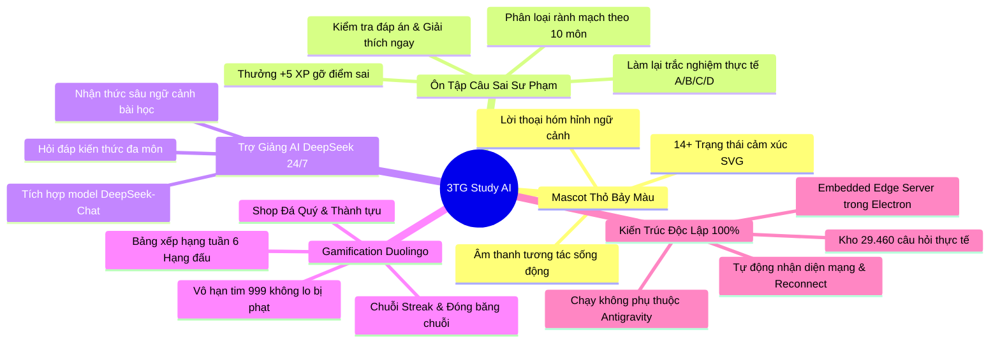

# 🌟 TỔNG HỢP CÁC CHỨC NĂNG ĐẲNG CẤP NHẤT — 3TG STUDY AI
## Nền Tảng Học Tập Thông Minh Gamification Cùng Mascot Thỏ Bảy Màu & Trợ Giảng AI DeepSeek

> **Phiên bản:** 1.0.0 Commercial Release  
> **Nền tảng:** Web Progressive App & Ứng dụng Desktop Windows (Electron Portable / NSIS)  
> **Cơ sở hạ tầng:** Cloudflare D1 (Database 29,460 câu hỏi) • Cloudflare R2 (Lưu trữ media) • DeepSeek AI Engine  

---

---

## 🏆 TOP 7 TÍNH NĂNG ĐẲNG CẤP & KHÁC BIỆT NHẤT

---

### 1. 🐰 Động Cơ Mascot Thỏ Bảy Màu Sống Động Độc Quyền (14+ Trạng Thái)
Không sử dụng hình ảnh tĩnh thông thường, 3TG Study sở hữu **bộ engine Mascot Thỏ Bảy Màu thuần Vector SVG** có khả năng biến đổi trạng thái cảm xúc theo từng hành vi học tập của học viên:

* **14+ Trạng thái cảm xúc sinh động:**
  * `IDLE`: Thỏ đứng nháy mắt, vẫy tay chào đón học viên.
  * `THINKING`: Thỏ chống cằm suy nghĩ khi học viên đang phân vân chọn đáp án.
  * `CHEERING` / `PARTY`: Nhảy múa tung pháo hoa khi trả lời đúng hoặc vượt qua bài kiểm tra.
  * `DETECTIVE_FIX`: Thỏ cầm kính lúp soi xét từng lỗi sai trong chuyên mục Ôn tập câu sai.
  * `KING_CHAMPION`: Thỏ đội vương miện hoàng gia vàng rực khi hoàn thành 100% bài ôn tập.
  * `CRYING` / `COLD_SWEAT`: Biểu cảm tiếc nuối khi chọn nhầm đáp án, đổ mồ hôi hột hài hước nhưng luôn kèm lời động viên.
  * `STREAK_FIRE`: Bừng cháy năng lượng chuỗi ngày học liên tục.
* **Hộp thoại thông minh (Contextual Speech Bubbles):** Lời thoại tiếng Việt tự nhiên, hài hước, biến hóa theo thời gian thực (được định vị thông minh trên/dưới/trái/phải tránh đè nội dung).
* **Âm thanh tương tác (Sound Effects FX):** Tích hợp trọn bộ âm thanh hoạt hình tươi vui khi bấm nút, trả lời đúng (`correct`), chọn sai (`wrong`), nổ chuỗi streak và hoàn thành màn chơi.

---

### 2. 🎯 Cỗ Máy "Ôn Tập Câu Sai" Chuẩn Sư Phạm Trắc Nghiệm Mới Nhất
Khắc phục hoàn toàn nhược điểm của các ứng dụng học vẹt, hệ thống ôn tập câu sai đã được tái định hình thành một **phòng luyện thi cá nhân hóa**:

* **Phân chia câu sai rành mạch theo 10 Môn học:**
  * Tuyệt đối **không gây nhầm lẫn** giữa câu hỏi môn này với môn khác.
  * Hệ thống chia tab bộ lọc môn học trên thanh điều hướng và hiển thị danh mục riêng cho từng môn học kèm số lượng câu cần củng cố.
* **Làm lại câu trắc nghiệm thực thụ (Active Recall):**
  * Hiển thị câu hỏi nguyên bản với các lựa chọn đáp án trắc nghiệm **A, B, C, D**.
  * Học viên trực tiếp tương tác, bấm chọn đáp án và ấn **"Kiểm tra đáp án"**.
* **Phản hồi tức thì & Khắc sâu kiến thức:**
  * **Chọn Đúng:** Banner xanh lá rực rỡ, phát âm thanh chúc mừng, thưởng ngay **+5 XP ⭐**, đồng thời tự động xóa câu đó khỏi danh sách câu sai vì bạn đã thực sự làm chủ kiến thức.
  * **Chọn Sai:** Banner đỏ hiển thị **đáp án đúng chính xác** kèm **lời giải thích chi tiết cặn kẽ** tại sao đáp án đó đúng, giúp học viên hiểu bản chất vấn đề ngay tại chỗ.
* **Nút "Làm lại câu này ➔":** Cho phép ôn lại cấp tốc từng câu đơn lẻ bất kỳ lúc nào mà không bắt buộc phải làm hết cả bộ đề.

---

### 3. 🤖 Trợ Giảng AI DeepSeek Siêu Trí Tuệ Tích Hợp Sẵn 24/7
Ứng dụng tích hợp trực tiếp mô hình ngôn ngữ lớn **DeepSeek-Chat** tốc độ siêu tốc (~470ms) phục vụ như một gia sư riêng:

* **Hỏi đáp thông minh theo ngữ cảnh:** AI tự động đọc hiểu bạn đang học bài nào, thuộc môn học nào để đưa ra câu trả lời bám sát giáo trình.
* **Giải bài tập & Phân tích thuật toán:** Giải thích code C++, Java, thuật toán Cấu trúc dữ liệu, sơ đồ CSDL quan hệ hoặc pháp lý CNTT bằng tiếng Việt chuẩn xác, dễ hiểu.
* **Phong cách đồng hành hóm hỉnh:** Tích hợp tính cách Thỏ Bảy Màu thân thiện, giải thích vừa mang tính học thuật cao vừa vui tươi, xóa tan áp lực học tập căng thẳng.
* **Lịch sử hội thoại nhiều phiên:** Tự động ghi nhớ các phiên chat theo tài khoản để học viên dễ dàng xem lại ghi chú ôn thi.

---

### 4. 🎮 Hệ Sinh Thái Gamification Đỉnh Cao Theo Phong Cách Duolingo
Biến việc học đại học khô khan thành một trò chơi vượt ải hấp dẫn:

| Tính Năng Gamification | Cơ Chế Hoạt Động | Giá Trị Cho Học Viên |
|---|---|---|
| **Vô Hạn Tim Vĩnh Viễn (999 ❤️)** | Thiết lập mặc định 999 trái tim, làm sai không bị trừ cạn tim | Học tập thoải mái không lo bị khóa tài khoản hoặc gián đoạn giữa chừng |
| **Chuỗi Ngày Học (Streak 🔥)** | Tính chuỗi ngày học liên tục theo múi giờ Việt Nam (GMT+7) | Tạo động lực duy trì thói quen học tập mỗi ngày |
| **Đóng Băng Chuỗi (Streak Freeze ❄️)** | Tự động kích hoạt khi có 1 ngày bận rộn không thể vào app | Bảo vệ chuỗi ngày học không bị đứt đoạn đáng tiếc |
| **Kinh Tế Đá Quý (Gems 💎)** | Thưởng đá quý khi hoàn thành bài học, lên cấp, đạt thành tích | Tích lũy để mua sắm vật phẩm trong Cửa Hàng |
| **Đấu Trường Bảng Xếp Hạng 🏆** | 6 Giải đấu tuần: *Đồng $\rightarrow$ Bạc $\rightarrow$ Vàng $\rightarrow$ Lam Ngọc $\rightarrow$ Kim Cương $\rightarrow$ Vô Địch* | Đua top XP hàng tuần cùng bạn bè, tự động thăng hạng / trụ hạng |
| **Cửa Hàng & Tủ Đồ 🛍️** | Mua vật phẩm trợ giúp, gói avatar độc quyền Thỏ Bảy Màu | Cảm giác sở hữu và tùy biến nhân vật cá nhân |

---

### 5. ⚡ Kiến Trúc Độc Lập Tuyệt Đối — Embedded Edge-in-Electron
Đột phá kỹ thuật đưa toàn bộ sức mạnh Cloudflare Edge Worker vào bên trong ứng dụng Desktop Windows:

* **Embedded HTTP Server nội bộ (`embedded-server.cjs`):**
  * Khi mở file `.exe`, Electron tự động khởi chạy máy chủ nhúng Node.js độc lập.
  * **Không cần bất kỳ dòng lệnh nào**, không cần mở terminal, **tắt hoàn toàn Antigravity app vẫn chạy phà phà**.
  * Tự động dò tìm cổng trống nếu cổng mặc định bị chiếm dụng.
* **Kết nối trực tiếp Cloudflare D1 & R2 qua HTTPS:**
  * Dữ liệu đồng bộ trực tiếp lên đám mây toàn cầu với độ trễ tính bằng mili-giây.
  * Tự động dự phòng thông tin xác thực, đảm bảo người dùng tải app về máy là dùng được ngay.
* **Cơ chế phát hiện mạng thông minh (Network Guard):**
  * Tự động lắng nghe sự kiện `online` / `offline`.
  * Khi đứt cáp hoặc mất Wi-Fi, app hiển thị màn hình thông báo cute của Mascot Thỏ Bảy Màu và tự động khôi phục dữ liệu ngay khi có mạng trở lại mà không bắt tải lại trang.

---

### 6. 📚 Kho Tri Thức Đại Học Khổng Lồ 100% Thực Tế (Không Bịa Đặt)
Toàn bộ học liệu được số hóa công phu từ hệ thống đào tạo đại học chính quy CMC University:

* **10 Môn học nòng cốt:**
  1. *Kỹ năng mềm và tư duy khởi nghiệp* (1.493 câu trắc nghiệm)
  2. *Cấu trúc dữ liệu và giải thuật* (4.400 câu trắc nghiệm)
  3. *Cơ sở dữ liệu* (6.664 câu trắc nghiệm)
  4. *Công nghệ phần mềm* (2.313 câu trắc nghiệm)
  5. *Nhập môn Công nghệ Thông tin* (1.554 câu trắc nghiệm)
  6. *Pháp lý và Đạo đức nghề nghiệp* (2.738 câu trắc nghiệm)
  7. *Toán rời rạc* (1.259 câu trắc nghiệm)
  8. *Cơ sở lập trình* (2.326 câu trắc nghiệm)
  9. *Lập trình hướng đối tượng OOP* (2.235 câu trắc nghiệm)
  10. *Phát triển ứng dụng web* (4.478 câu trắc nghiệm)
* **Tổng cộng:** **106 Chương học**, **4.094 Bài giảng slide**, **29.460 Câu hỏi trắc nghiệm chuẩn hóa** kèm lời giải thích sư phạm.

---

### 7. 🎨 Ngôn Ngữ Thiết Kế Claymorphism & Duolingo 3D Cực Kèm Mắt
Giao diện đạt tiêu chuẩn thẩm mỹ cao cấp (*Rich Aesthetics*):

* **Hiệu ứng nút bấm 3D Tactile:** Các nút bấm có viền đậm và lớp đế dày (3D depth) tạo cảm giác nhấn nảy vật lý cực kỳ đã tay.
* **Tone màu Lumi Pink quyến rũ:** Màu chủ đạo `#ff4b82` phối cùng các gam màu ngọc bích, vàng kim và tím pastel giúp giao diện luôn tươi mới, kích thích sự sáng tạo.
* **Trải nghiệm trang cá nhân chuyên nghiệp:**
  * Tài khoản mới đăng ký tự động được tạo hồ sơ sạch sẽ, không bị dính dữ liệu rác.
  * Hỗ trợ tải ảnh đại diện lên Cloudflare R2 hoặc chọn nhanh kho Avatar phong cách Thỏ Bảy Màu có sẵn.

---

## 📦 CÁC BẢN PHÂN PHỐI ỨNG DỤNG SẴN CÓ

| Định dạng file | Đường dẫn trong thư mục dự án | Mô tả cách dùng |
|---|---|---|
| **Bản Portable (.exe)** | [`dist-electron/3TG Học Vui Mỗi Ngày 1.0.0.exe`](file:///c:/Users/LeVanAn/Documents/ChatGPT/app%20study%202/dist-electron/3TG%20H%E1%BB%8Dc%20Vui%20M%E1%BB%97i%20Ng%C3%A0y%201.0.0.exe) | File chạy ngay không cần cài đặt. Copy vào USB hoặc bất kỳ máy nào mở lên học ngay. |
| **Bản Cài Đặt (Setup .exe)** | [`dist-electron/3TG Học Vui Mỗi Ngày Setup 1.0.0.exe`](file:///c:/Users/LeVanAn/Documents/ChatGPT/app%20study%202/dist-electron/3TG%20H%E1%BB%8Dc%20Vui%20M%E1%BB%97i%20Ng%C3%A0y%20Setup%201.0.0.exe) | Trình cài đặt chuẩn Windows NSIS, tự tạo Icon trên Desktop và Start Menu. |
| **Thư mục Unpacked** | [`dist-electron/win-unpacked/3TG Học Vui Mỗi Ngày.exe`](file:///c:/Users/LeVanAn/Documents/ChatGPT/app%20study%202/dist-electron/win-unpacked/3TG%20H%E1%BB%8Dc%20Vui%20M%E1%BB%97i%20Ng%C3%A0y.exe) | Bản giải nén trực tiếp dành cho nhà phát triển kiểm tra nhanh. |
| **Phiên bản Web / Edge** | Chạy qua máy chủ nhúng `http://127.0.0.1:8787` | Trải nghiệm trực tiếp trên trình duyệt Chrome, Edge, Safari. |

---
*Tài liệu được biên soạn tự động — Hệ thống giáo dục thông minh 3TG Study AI 2026.*
