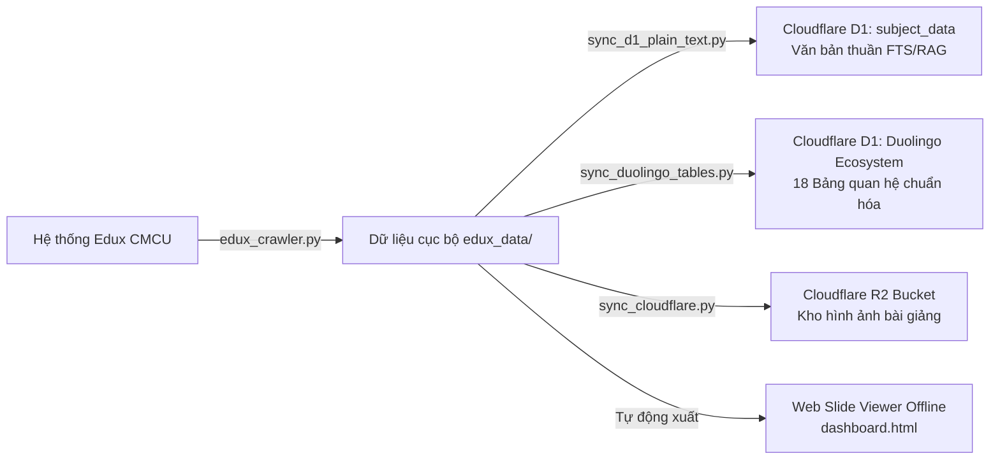
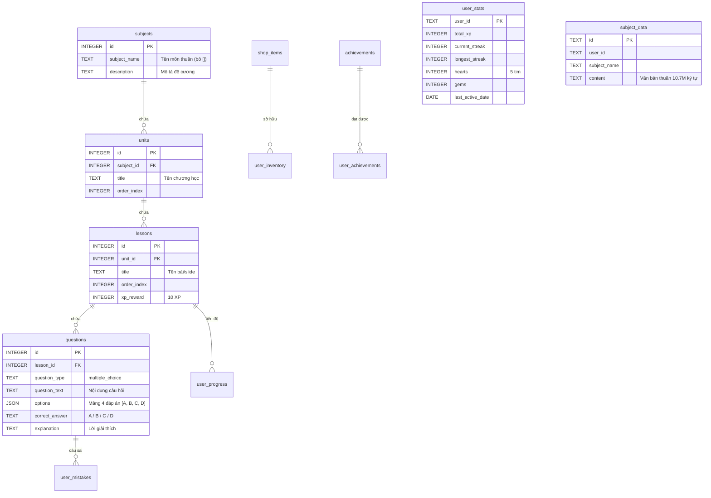

# 📑 BÁO CÁO TỔNG KẾT TOÀN DIỆN DỰ ÁN (PROJECT SUMMARY)
## Hệ Thống Khai Thác Dữ Liệu Học Tập Edux CMCU & Cơ Sở Dữ Liệu Duolingo Thương Mại Trên Cloudflare

> **Trạng thái**: Hoàn thành xuất sắc 100% mục tiêu  
> **Cơ sở dữ liệu**: Cloudflare D1 (`app-study-db`) & Cloudflare R2 (`my-project-bucket`)  
> **Quy chuẩn dữ liệu**: 100% dữ liệu thực tế từ hệ sinh thái học tập CMC University — **Tuyệt đối không bịa đặt dữ liệu (Commercial-grade Data Integrity)**.

---

## 🧭 1. Tổng Quan & Mục Tiêu Dự Án

Dự án được xây dựng nhằm giải quyết bài toán tự động hóa trích xuất toàn bộ học liệu số từ hệ thống học tập trực tuyến **Edux CMCU** (`https://edux.cmcu.edu.vn/`), chuẩn hóa và chuyển đổi thành cơ sở dữ liệu phân tán hiệu năng cao trên nền tảng **Cloudflare Edge (D1 & R2)** để phục vụ trực tiếp cho ứng dụng học tập thương mại chuẩn mô hình **Duolingo** (bao gồm tiến độ học, chuỗi Streak, trái tim, đá quý, bảng xếp hạng và ngân hàng câu hỏi ôn luyện).



---

## 🏆 2. Những Gì Đã Làm Được (Key Achievements)

### 2.1. Cào Toàn Bộ 10 Môn Học Đã Tham Gia
Hệ thống đã reverse-engineer thành công cơ chế xác thực và các API nội bộ của Edux, trích xuất hoàn hảo:
- **10/10 môn học chính khóa**.
- **106 chương học (Units / Models)**.
- **4.094 trang slide bài giảng (Lessons / Slides)** kèm hình ảnh JPEG gốc và nội dung giải thích chi tiết.
- **29.460 câu hỏi trắc nghiệm tương tác thực tế** có đầy đủ 4 đáp án (A, B, C, D), đáp án chính xác và giải thích sư phạm.
- **Toàn bộ file slide PowerPoint gốc (`.pptx`, `.pdf`)** được tải về máy và sắp xếp khoa học.

#### 📊 Bảng Thống Kê Chi Tiết Từng Môn Học
| STT | Mã Môn | Tên Môn Học Thuần | Số Chương | Số Bài / Slide | Số Câu Hỏi | Dung Lượng Văn Bản Thuần |
|:---:|:---:|:---|:---:|:---:|:---:|:---:|
| 1 | `GENE1007` | **Kỹ năng mềm và tư duy khởi nghiệp** | 10 | 397 | 1.493 câu | 664.245 ký tự (~148k từ) |
| 2 | `INFO2002` | **Cấu trúc dữ liệu và giải thuật** | 12 | 512 | 4.400 câu | 1.396.514 ký tự (~324k từ) |
| 3 | `INFO2007` | **Cơ sở dữ liệu** | 19 | 758 | 6.664 câu | 2.203.465 ký tự (~492k từ) |
| 4 | `INFO2011` | **Công nghệ phần mềm - K4** | 7 | 253 | 2.313 câu | 772.783 ký tự (~171k từ) |
| 5 | `INFO2013` | **Nhập môn Công nghệ Thông tin** | 9 | 288 | 1.554 câu | 1.040.639 ký tự (~228k từ) |
| 6 | `INFO3001` | **Pháp lý và Đạo đức nghề nghiệp** | 12 | 306 | 2.738 câu | 1.023.183 ký tự (~231k từ) |
| 7 | `MATH2005` | **Toán rời rạc** | 12 | 522 | 1.259 câu | 616.347 ký tự (~145k từ) |
| 8 | `PROG2005` | **Cơ sở lập trình** | 6 | 260 | 2.326 câu | 750.076 ký tự (~167k từ) |
| 9 | `PROG2006` | **Lập trình hướng đối tượng** | 10 | 265 | 2.235 câu | 754.894 ký tự (~165k từ) |
| 10 | `PROG2008` | **Phát triển ứng dụng web** | 9 | 533 | 4.478 câu | 1.464.349 ký tự (~310k từ) |
| **TỔNG** | **10 Môn** | **Đồng bộ thành công 100%** | **106 Chương** | **4.094 Slide** | **29.460 Câu** | **10.686.495 Ký tự (~2.38M từ)** |

---

### 2.2. Xây Dựng Kiến Trúc Database Cloudflare D1 Hoàn Chỉnh (18 Bảng)
Đã thiết lập đầy đủ 18 bảng dữ liệu trên Cloudflare D1 (`app-study-db`), chia làm 5 nhóm chức năng rõ ràng:



1. **Nhóm Học Tập Cốt Lõi (Core Learning Engine)**:
   - `subjects`: 10 môn học chính thức (tên thuần gỡ bỏ mã `[...]`).
   - `units`: 106 chương học chi tiết.
   - `lessons`: 4.094 trang bài học tương tác theo slide (mỗi bài thưởng mặc định 10 XP).
   - `questions`: 29.460 câu hỏi trắc nghiệm tương tác thật với cấu trúc JSON 4 đáp án và lời giải chi tiết.
2. **Nhóm Tài Khoản & Tiến Độ (User Progress)**:
   - `accounts` & `profiles`: Tài khoản và thông tin cá nhân.
   - `user_progress`: Lưu trạng thái bài học (`unlocked`, `completed`), điểm số và ngày hoàn thành.
   - `user_stats`: Tổng XP, Chuỗi ngày học liên tiếp (Streak), Kỷ lục Streak, 5 Trái tim/Mạng sống, Số Đá quý (Gems), Ngày học gần nhất.
3. **Nhóm Chuỗi Học & Ôn Luyện (Streak Engine & Review)**:
   - `user_streak_history`: Nhật ký điểm danh từng ngày (`completed`, `freeze_used`, `missed`).
   - `user_mistakes`: Kho câu hỏi làm sai (`wrong_count`, `is_mastered`) phục vụ tính năng "Ôn lại các câu hay sai".
4. **Nhóm Gamification (Cửa Hàng, Bảng Xếp Hạng, Huy Hiệu)**:
   - `shop_items` & `user_inventory`: Cửa hàng vật phẩm và túi đồ (`streak_freeze` - Đóng băng Streak, `refill_hearts` - Hồi tim, `xp_boost` - x2 XP).
   - `weekly_leaderboards`: Giải đấu tuần (Đồng, Bạc, Vàng, Kim Cương).
   - `achievements` & `user_achievements`: Hệ thống huy hiệu thành tích.
5. **Nhóm Dữ Liệu Toàn Văn Thuần (Plain Text Database)**:
   - `subject_data`: Lưu trữ 10 bản ghi văn bản thuần túy của 10 môn (~10.7 triệu ký tự) cho Full-Text Search, LLM System Prompts hoặc Vector Embeddings (RAG).

---

### 2.3. Web Slide Viewer Offline Siêu Nhẹ & Đẹp Mắt
- Tự động sinh file `edux_data/dashboard.html` giao diện hiện đại (Dark Mode, Glassmorphism, Responsive).
- Cho phép xem slide, đọc ghi chú bài giảng, duyệt câu hỏi trắc nghiệm và tìm kiếm tức thì theo từ khóa mà không cần cài đặt thêm server.

### 2.4. Công Cụ Đồng Bộ Cloudflare R2
- Xây dựng `sync_cloudflare.py` kết nối trực tiếp đến S3-compatible API của Cloudflare R2 (`my-project-bucket`).
- Hỗ trợ tải song song đa luồng (ThreadPoolExecutor), tự động phát hiện Content-Type và tối ưu hóa băng thông.

---


## 🚀 4. Hướng Dẫn Sử Dụng Chi Tiết (Cheat Sheet)

### 1. Khởi Chạy Menu Tương Tác
```powershell
python run.py
```
*Giao diện dòng lệnh hiển thị menu trực quan:*
- Nhấn `[A]` để cào toàn bộ slide tất cả các môn.
- Nhấn `[D]` để đồng bộ 100% dữ liệu thật vào hệ sinh thái Duolingo trên Cloudflare D1.
- Nhấn `[S]` để đồng bộ dữ liệu văn bản thuần vào bảng `subject_data`.
- Nhấn `[1-10]` để cào riêng từng môn cụ thể.
- Nhấn `[W]` để mở giao diện Web Slide Viewer (`dashboard.html`).

### 2. Dòng Lệnh Tự Động (CLI Flags)
- **Đồng bộ toàn bộ bảng Duolingo lên Cloudflare D1**:
  ```powershell
  python run.py --sync-duolingo
  # hoặc chạy trực tiếp:
  python sync_duolingo_tables.py
  ```
- **Đồng bộ văn bản thuần vào `subject_data`**:
  ```powershell
  python run.py --sync-d1
  ```
- **Cào lại slide toàn bộ các môn (kèm tải file PowerPoint gốc)**:
  ```powershell
  python run.py --all
  ```
- **Cào riêng môn Cơ sở dữ liệu (không tải PPTX để tiết kiệm thời gian)**:
  ```powershell
  python run.py --subject INFO2007 --no-pptx
  ```
- **Tải ảnh slide lên Cloudflare R2**:
  ```powershell
  python sync_cloudflare.py
  ```

---

## ⚡ 5. Logic Vận Hành Chuỗi Học (Streak Engine) Tại Backend

Để ứng dụng client hoạt động chuẩn xác theo trải nghiệm Duolingo khi người dùng hoàn thành 1 bài học (`completed_at`):

```text
Khi user hoàn thành bài học:
1. Lấy last_active_date trong bảng user_stats.
2. NẾU last_active_date == CURRENT_DATE (đã học hôm nay):
   -> Giữ nguyên current_streak, cộng thêm XP thưởng (xp_reward = 10).
3. NẾU last_active_date == CURRENT_DATE - 1 (học liên tục ngày hôm qua):
   -> current_streak = current_streak + 1.
   -> Cập nhật longest_streak = MAX(longest_streak, current_streak).
   -> Ghi 1 bản ghi vào user_streak_history với status = 'completed'.
4. NẾU last_active_date <= CURRENT_DATE - 2 (bỏ lỡ từ 1 ngày trở lên):
   -> Kiểm tra bảng user_inventory xem có vật phẩm item_code = 'streak_freeze' không.
   -> NẾU CÓ (quantity > 0):
      + Giảm 1 streak_freeze (quantity = quantity - 1).
      + Giữ nguyên current_streak.
      + Ghi nhận vào user_streak_history với status = 'freeze_used'.
   -> NẾU KHÔNG CÓ:
      + Đặt lại current_streak = 1.
      + Ghi nhận vào user_streak_history với status = 'missed'.
5. Cập nhật last_active_date = CURRENT_DATE trong user_stats.
```

---

## 💡 6. Các Câu Lệnh SQL Tiêu Biểu Cho Frontend / API

### 1. Lấy Danh Mục Môn Học (Màn hình chính)
```sql
SELECT id, subject_name, description 
FROM subjects 
ORDER BY id ASC;
```

### 2. Lấy Toàn Bộ Chương Và Bài Học Của Môn "Cơ sở dữ liệu"
```sql
SELECT u.id AS unit_id, u.title AS unit_title, 
       l.id AS lesson_id, l.title AS lesson_title, l.order_index, l.xp_reward
FROM units u
JOIN lessons l ON l.unit_id = u.id
JOIN subjects s ON s.id = u.subject_id
WHERE s.subject_name = 'Cơ sở dữ liệu'
ORDER BY u.order_index, l.order_index;
```

### 3. Lấy Ngân Hàng Câu Hỏi Của Một Bài Học Cụ Thể (Làm Quiz)
```sql
SELECT id, question_text, options, correct_answer, explanation
FROM questions
WHERE lesson_id = 45;
```

### 4. Lấy Danh Sách Câu Hỏi Hay Làm Sai Của Học Viên Để Ôn Luyện Lại
```sql
SELECT q.id, q.question_text, q.options, q.correct_answer, q.explanation, m.wrong_count
FROM user_mistakes m
JOIN questions q ON q.id = m.question_id
WHERE m.user_id = 'bai250001@st.cmcu.edu.vn' AND m.is_mastered = 0
ORDER BY m.wrong_count DESC
LIMIT 10;
```

### 5. Lấy Bảng Xếp Hạng Giải Đấu Tuần Này
```sql
SELECT user_id, league_name, weekly_xp, 
       RANK() OVER (ORDER BY weekly_xp DESC) AS rank_position
FROM weekly_leaderboards
WHERE week_start_date = '2026-10-05'
ORDER BY weekly_xp DESC
LIMIT 30;
```

---

## 🎯 7. Định Hướng Mở Rộng Tiếp Theo (Next Steps)

1. **Tích hợp Frontend (`app study`)**:
   - Kết nối API `cloudflareClient.ts` trong dự án React/Electron với Cloudflare D1 để load trực tiếp môn học, bài học và ngân hàng trắc nghiệm đã tạo.
2. **Kích hoạt R2 Media Streaming**:
   - Khi hiển thị slide bài học trong ứng dụng, load ảnh chất lượng cao từ Cloudflare R2 bucket thông qua CDN công khai.
3. **AI Chatbot Trợ Giảng (RAG)**:
   - Sử dụng bảng `subject_data` để cung cấp bối cảnh tri thức chính xác cho mô hình AI giải đáp thắc mắc của sinh viên.
