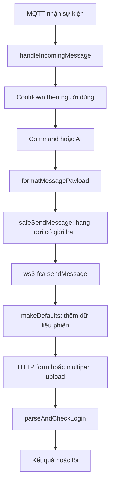

# Phân tích tích hợp Facebook Messenger trong workspace

Ngày kiểm tra: 05/11/2026. Phiên bản thư viện đang cài: `ws3-fca@3.5.2`. Môi trường kiểm thử: Node.js `v24.21.0`.

## 1. Kết luận về hướng phân tích payload và header

Phân tích payload và header là hướng đúng để tìm lỗi giao thức, lỗi phiên và sự không tương thích của thư viện. Tuy nhiên, việc tạo được một request đúng định dạng không chứng minh tài khoản sẽ không bị checkpoint hoặc khóa. Mã phía máy khách không cho biết đầy đủ các tín hiệu và quyết định phía máy chủ của Facebook.

Workspace chứa mã bot và thư viện không chính thức, không chứa mã nguồn máy chủ Facebook. Báo cáo này dựa trên mã cục bộ và kiểm thử ngoại tuyến. Không đăng nhập, không gửi request tới Facebook, không dùng giá trị cookie/token thật. Công cụ tra cứu web không khả dụng trong phiên kiểm tra này, nên báo cáo không xác nhận phiên bản API, quyền hay chính sách Meta mới nhất.

Các kết luận về nguyên nhân Facebook xử lý một tài khoản cụ thể vẫn chưa thể xác định: hiện không có phản hồi lỗi đã được loại bỏ thông tin nhạy cảm hoặc phép đo thực tế để đối chiếu.

## 2. Luồng dữ liệu thực tế



Hai kênh khác nhau cần được phân biệt:

| Kênh | Mục đích trong mã hiện tại | Nguồn |
| --- | --- | --- |
| HTTP | Đăng nhập bằng cookie, lấy trang khởi tạo, upload và gửi nội dung | `src/utils/axios.js`, `apis/messaging/sendMessage.js` trong thư viện |
| MQTT qua WebSocket | Nhận sự kiện, typing, đánh dấu đã đọc | `apis/mqtt/listenMqtt.js`, `sendTypingIndicator.js`, `markAsRead.js` trong thư viện |

Việc bot nhận được sự kiện MQTT không chứng minh payload gửi HTTP đúng. Đổi một tùy chọn ở bot cũng chưa chứng minh cả hai kênh sử dụng tùy chọn đó.

Hàng đợi hiện chỉ bao phủ các đường gửi đi qua `safeSendMessage`. Một số thao tác gọi API trực tiếp, như thu hồi tin, và request nội bộ của thư viện nằm ngoài hàng đợi này.

## 3. Cấu trúc payload: tầng ứng dụng và tầng transport

### 3.1. Payload ứng dụng của bot

Trong [index.js](index.js), `formatMessagePayload` chuyển phản hồi thành:

- Chuỗi văn bản, nếu chỉ gửi chữ.
- Object `{ body, attachment }` nếu có tệp đính kèm; `attachment` phải là readable stream.

Đầu vào của adapter có thể là `content`, `body`, Discord embed hoặc `files`. Adapter hiện chỉ lấy embed đầu tiên và file đầu tiên. Đây là giới hạn chuyển đổi của bot, không phải giới hạn đã xác nhận của Facebook.

Tại [sendMessage.js](node_modules/ws3-fca/src/deltas/apis/messaging/sendMessage.js), hàm thực tế có chữ ký:

```js
sendMessage(msg, threadID, replyToMessage, isSingleUser = false)
// Trả Promise; đối số thứ ba là reply ID, không phải callback.
```

Các thuộc tính được thư viện cho phép gồm `body`, `attachment`, `url`, `sticker`, `emoji`, `emojiSize`, `mentions`, `location`. Cho phép một thuộc tính không chứng minh mọi nhánh triển khai đều hoạt động: ví dụ nhánh chia sẻ URL thiếu giá trị trả về từ `getUrl`, và nhánh upload có thể tham chiếu biến `resData` chưa khai báo khi báo lỗi.

Bot hiện không chuyển tiếp tham số `isSingleUser` thứ tư. Cần phân biệt ID cuộc hội thoại với ID người dùng; không nên gán mọi lỗi định tuyến hội thoại thành checkpoint.

### 3.2. Những nhóm dữ liệu được thư viện thêm vào request

| Nhóm | Ví dụ tên trường | Nguồn dữ liệu / vai trò |
| --- | --- | --- |
| Nội dung | `body`, metadata tệp đính kèm | Từ command/AI và kết quả upload |
| Định tuyến | `thread_fbid` hoặc các trường người nhận | Phụ thuộc loại cuộc hội thoại và `isSingleUser` |
| Người gửi | `author`, `av`, `__user` | Danh tính của phiên đang đăng nhập |
| Định danh lần gửi | `message_id`, `offline_threading_id`, `threading_id` | Thư viện tạo cho lần gọi; không phải chứng nhận người thật |
| Phản hồi tin | `replied_to_message_id` | Reply ID từ sự kiện đầu vào |
| Ngữ cảnh trang | `__rev`, `__req`, `__a` | Revision trang và bộ đếm request của thư viện |
| Ngữ cảnh phiên / chống CSRF | `fb_dtsg`, `jazoest` | Từ dữ liệu khởi tạo và context phiên của thư viện |

Nguồn chính: [makeDefaults](node_modules/ws3-fca/src/utils/index.js), [buildAPI](node_modules/ws3-fca/src/core/models/buildAPI.js) và [sendMessage](node_modules/ws3-fca/src/deltas/apis/messaging/sendMessage.js).

Không tồn tại một bộ giá trị tĩnh “chuẩn chống quét” được chứng minh trong các file này. Cookie xác thực và dữ liệu phiên phải được phân biệt với nội dung tin, metadata phiên bản và định danh lần gửi. Copy các trường từ phiên khác không chứng minh request còn hợp lệ.

### 3.3. Kiểu mã hóa

[axios.js](node_modules/ws3-fca/src/utils/axios.js) mặc định mã hóa POST thành `application/x-www-form-urlencoded`; nhánh upload dùng `multipart/form-data` cùng boundary của `FormData`. Không thể áp JSON body cho mọi đường gọi rồi giữ nguyên các header cũ.

Đối với object lồng nhau, mã có `JSON.stringify`; với array, `URLSearchParams.append` có thể chuyển thành chuỗi nối bằng dấu phẩy. Cần kiểm tra hợp đồng từng endpoint khi điều tra lỗi attachment; chưa có kiểm chứng tương thích trực tiếp với Facebook trong báo cáo này.

## 4. Header: các phát hiện có bằng chứng

| Phát hiện | Bằng chứng trong mã | Kết luận được phép rút ra |
| --- | --- | --- |
| HTTP bỏ qua `options.userAgent` | `getHeaders` gọi `randomUserAgent()` trực tiếp, không đọc `options` | Chuỗi UA cấu hình trong bot không điều khiển HTTP header ở phiên bản này |
| MQTT dùng UA cấu hình | `listenMqtt` đọc `ctx.globalOptions.userAgent` và đưa vào handshake | Hai kênh không có cùng nguồn UA |
| Có thể tạo header LSD có giá trị `undefined` | `if (ctx.fb_dtsg)` rồi gán `ctx.lsd` | Điều kiện kiểm tra khác biến được dùng; `buildAPI` được đọc không khởi tạo `lsd` |
| Fetch metadata được gắn chung | `Sec-Fetch-Dest=document`, `Sec-Fetch-Mode=navigate` trong hàm header chung | Metadata không mô tả đúng mọi loại thao tác HTTP; chưa chứng minh đây là nguyên nhân khóa tài khoản |
| Cookie HTTP được gắn qua cookie jar | Axios instance được tạo cùng `jar`, login dùng `utils.getJar()` | Không thấy `Cookie` trong object `getHeaders` không đồng nghĩa request không có cookie |
| Jar HTTP dùng chung ở cấp module | `const jar = new CookieJar()` và một axios instance dùng chung | Không nên suy diễn tham số `reqJar` tạo sự cô lập giữa nhiều tài khoản |

Nguồn: [headers.js](node_modules/ws3-fca/src/utils/headers.js), [axios.js](node_modules/ws3-fca/src/utils/axios.js), [loginHelper.js](node_modules/ws3-fca/src/core/models/loginHelper.js), [listenMqtt.js](node_modules/ws3-fca/src/deltas/apis/mqtt/listenMqtt.js).

Đã gọi riêng `getHeaders` ngoại tuyến với UA và token giả: xác nhận UA trả về không phải UA truyền vào; xác nhận `X-Fb-Lsd` là thuộc tính có giá trị `undefined` khi context chỉ có `fb_dtsg`. Đây là kết quả trước bước serialization của axios. Nó không chứng minh một header có chuỗi literal `undefined` thực sự được truyền qua mạng.

Không sửa header trong `node_modules`: thay đổi ở đó không bền qua cài lại dependencies, và chỉnh dấu vết trình duyệt không giải quyết hợp đồng API hay quyền truy cập.

## 5. Lỗi thực tế của bot và thay đổi đã thực hiện

### 5.1. Gửi lại không phân loại lỗi

Mã trước sửa thử gửi lại bỏ reply ID với mọi lỗi của tin có reply. Với timeout, HTTP 429 hay hết phiên, không có cơ sở kết luận reply ID sai. Nếu máy chủ đã nhận tin nhưng client mất phản hồi, gửi lại có thể tạo tin trùng.

Đã bỏ nhánh này trong [antiBan.js](src/utils/antiBan.js). Mỗi tác vụ chỉ gọi `api.sendMessage` một lần. Cũng bỏ nhánh đoán API callback bằng cách gọi gửi trước rồi gọi lần nữa; phiên bản đang cài dùng Promise.

Giới hạn: thư viện tự retry bên dưới. Một lần gọi hàm ở bot vẫn có thể dẫn đến nhiều request mạng, nên chưa thể cam kết giao tin đúng một lần.

### 5.2. Giới hạn hàng đợi và dừng gửi khi cần kiểm tra truy cập

Đã thêm `MAX_OUTBOX_QUEUE_SIZE`, mặc định 100 tin đang chờ ngoài tác vụ đang xử lý. Tin vượt giới hạn bị từ chối với `OUTBOX_FULL`, giúp tránh tích lũy công việc vô hạn trong hàng đợi này.

Khi thao tác gửi trả lỗi có status 429, hàng đợi dừng với `OUTBOX_RATE_LIMITED`. Status 401/403 hoặc thông báo xác thực rõ ràng làm dừng với `OUTBOX_AUTH_REQUIRED`. Các tin đang chờ bị từ chối; các yêu cầu gửi mới bị từ chối trước khi gọi API.

Không tự retry, không tự đăng nhập lại, không tự tiếp tục sau một khoảng thời gian phỏng đoán. Nếu nền tảng có thời gian chờ hoặc yêu cầu kiểm tra phiên, cần đáp ứng trước khi khởi động lại. Các tin bị từ chối không được phát lại tự động.

Classifier nhận status có cấu trúc hoặc thông báo lỗi cụ thể của `parseAndCheckLogin`. Nó không suy đoán checkpoint từ mọi timeout hay lỗi mạng. Nếu thư viện làm mất thông tin lỗi, classifier cũng không thể phục hồi thông tin đó.

### 5.3. Các chỉnh sửa liên quan

- Giữ khoảng nghỉ giữa các tác vụ ngay cả khi tác vụ gửi thất bại.
- `await` và bắt lỗi ở điểm dispatch sự kiện, thay vì để Promise lỗi rơi ra ngoài luồng xử lý.
- Không cố gửi thông báo lỗi command qua hàng đợi đã dừng.
- Ẩn URL proxy trong log, vì URL có thể chứa username/password.
- Loại trừ `appstate.json` và file tạm mặc định khỏi Git. Điều này không xóa lịch sử đã commit; workspace hiện không có Git metadata để kiểm tra lịch sử.
- Sửa mô tả, trạng thái và hướng dẫn đã hứa “bảo vệ 100%” hoặc coi lưu cookie là gia hạn phiên.

## 6. Những giới hạn còn lại cần hiểu đúng

| Cơ chế / vấn đề | Thực chất và phạm vi |
| --- | --- |
| Cooldown | So sánh thời điểm thao tác gần nhất, không phải token bucket. Admin được miễn |
| Typing và đánh dấu đã đọc | Thêm thao tác lên nền tảng; không có bằng chứng chúng bảo đảm tránh phát hiện |
| `HUMAN_TYPING=false` | Hiện chỉ đổi thời gian delay; chưa tắt toàn bộ lệnh typing/read của mã cũ |
| Bỏ qua tin của chính bot | Ngăn tự phản hồi, chưa chứng minh ngăn vòng lặp giữa hai bot khác nhau |
| Lưu AppState | Chép cookie hiện có từ jar xuống file, không chủ động gia hạn phiên phía máy chủ |
| Thông tin lỗi thư viện | Một số nhánh dùng `new Error(resData)` làm mất cấu trúc; HTTP 200 vẫn có thể chứa lỗi nghiệp vụ |
| Retry nội bộ | Axios helper thử lại lỗi transport; parser còn thử lại 5xx. Hàng đợi bot không kiểm soát hoàn toàn các lần này |
| MQTT reconnect | Có cơ chế reconnect riêng, chưa bị dừng bởi trạng thái outbox |
| Phạm vi tạm dừng | Chỉ các gửi đi qua outbox; không phải ngắt toàn bộ kết nối Facebook |
| Độ bền / bộ nhớ | Hàng đợi chưa lưu bền; các map người dùng chưa có dọn dẹp định kỳ; giới hạn outbox không giới hạn mọi nguồn cấp phát bộ nhớ |
| Log khác | Log login, MQTT, lỗi toàn cục và thư viện vẫn cần được rà soát; chưa có bộ lọc bí mật dùng chung |

Không nên chữa các giới hạn này bằng cách đổi UA ngẫu nhiên, thêm token đoán được hoặc lặp gửi thử tới khi thành công. Hướng xử lý là giữ thông tin lỗi có cấu trúc, giảm công việc không cần thiết, dừng khi mất quyền và dùng giao diện được hỗ trợ.

## 7. Hướng giải quyết lâu dài

Nếu mục tiêu là bot cho Facebook Page, thiết kế đề xuất là:

1. Page và ứng dụng Meta được cấp quyền phù hợp; xác minh phiên bản API và điều kiện triển khai hiện hành.
2. Webhook xác minh challenge và chữ ký trên raw body bằng app secret; chống xử lý lặp bằng định danh sự kiện.
3. Lưu bí mật ngoài mã nguồn; tách Page Access Token, App Secret và Webhook Verify Token theo đúng mục đích.
4. Chỉ tạo phản hồi được phép gửi; dùng payload và loại người nhận mà Messenger Platform hỗ trợ.
5. Queue có giới hạn, giữ lỗi API có cấu trúc, tuân thủ phản hồi giới hạn và không gửi lại thao tác có kết quả chưa xác định.
6. Theo dõi lỗi xác thực, quyền, giới hạn và lỗi nội dung riêng biệt, không ghi cookie/token vào log.

| Giá trị cho tích hợp Page | Vai trò |
| --- | --- |
| Page ID | Định danh Page gửi phản hồi |
| Page Access Token | Xác thực quyền gọi API của Page; không thay bằng cookie cá nhân |
| App Secret | Xác minh chữ ký webhook; không gửi xuống client |
| Webhook Verify Token | Bí mật cấu hình để xác minh bước đăng ký callback; khác với Access Token |
| Recipient PSID | ID người nhận trong phạm vi Page, từ sự kiện được phép xử lý; không mặc nhiên bằng UID cá nhân |
| Graph API version | Phiên bản đã được kiểm tra và cấu hình rõ ràng trước triển khai |

Đường dẫn tham khảo để đối chiếu trước khi xây dựng: [Messenger Platform](https://developers.facebook.com/docs/messenger-platform/). Không tuyên bố API chính thức giúp tài khoản miễn mọi hình thức hạn chế. Cũng không mặc nhiên thay thế được bot nick cá nhân trong nhóm chat hiện tại. Phần tích hợp Page chưa được triển khai trong lần sửa này.

## 8. Xác minh

```powershell
npm.cmd test
node --check index.js
node --check src/utils/antiBan.js
```

Kiểm thử dùng API giả để kiểm tra: chữ ký Promise và reply ID, không gửi lại sau timeout, không gửi lần hai để đoán callback, dừng tin chờ/tin mới khi gặp 401/403/429 hoặc thông báo xác thực rõ ràng, giới hạn hàng đợi, thứ tự FIFO, khoảng nghỉ sau lỗi và xác thực cấu hình dung lượng.

Các kiểm thử không chứng minh Facebook chấp nhận payload hiện tại, không đo khả năng tránh khóa tài khoản và không thay thế việc kiểm tra hợp đồng API được hỗ trợ.
